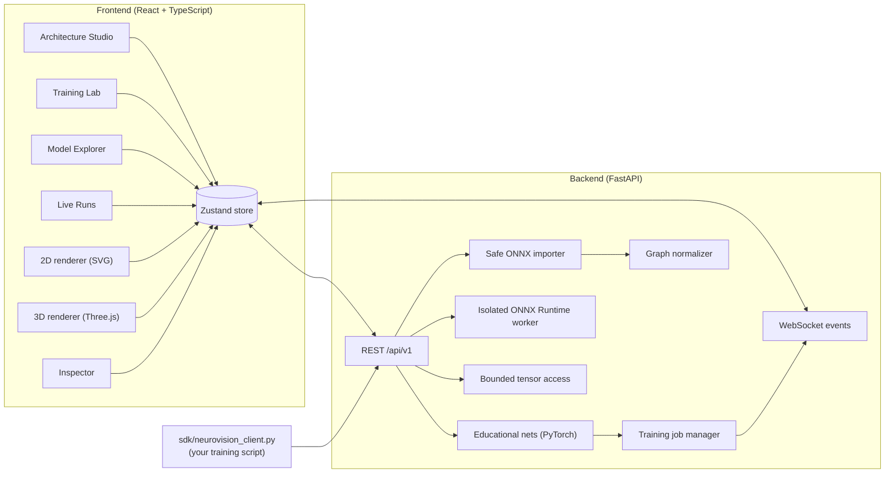
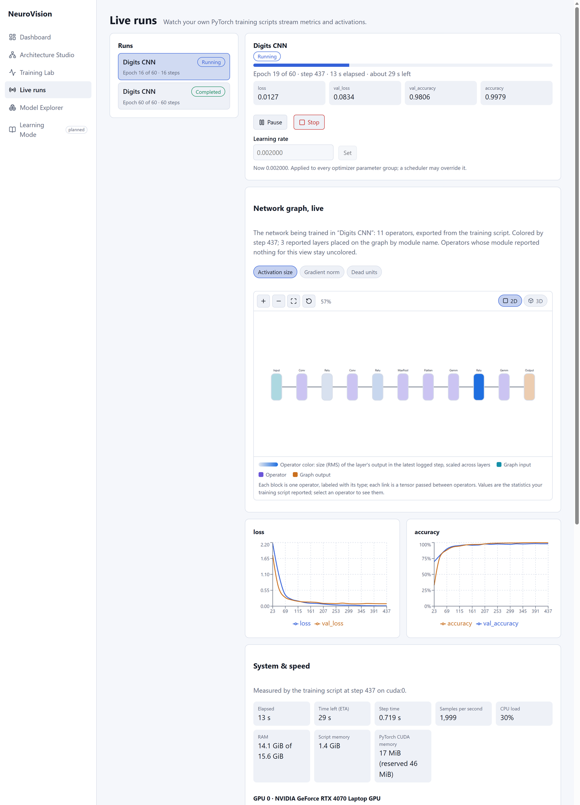
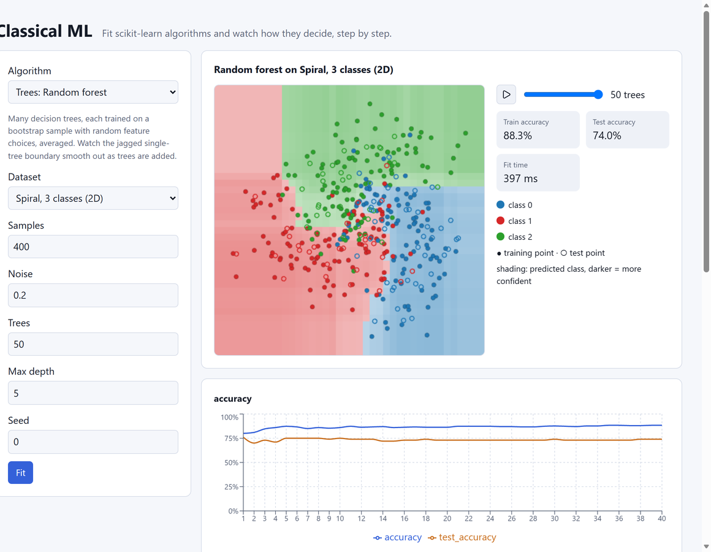
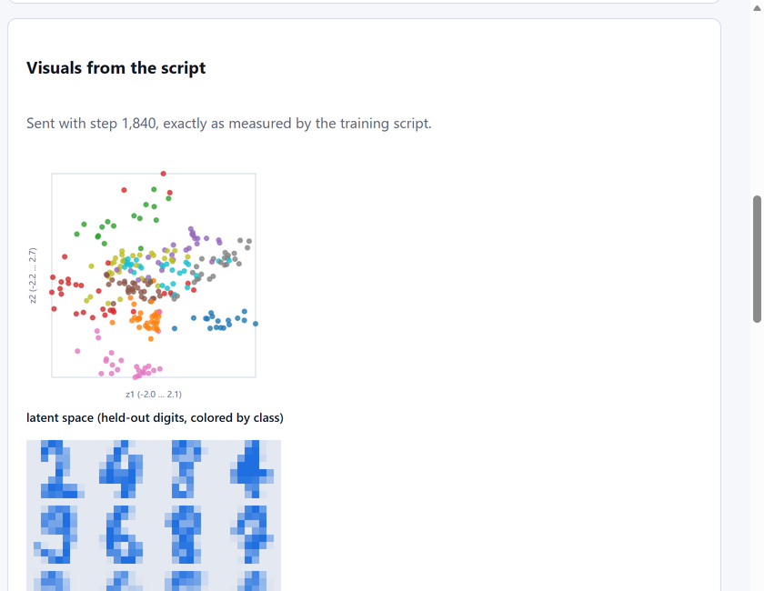
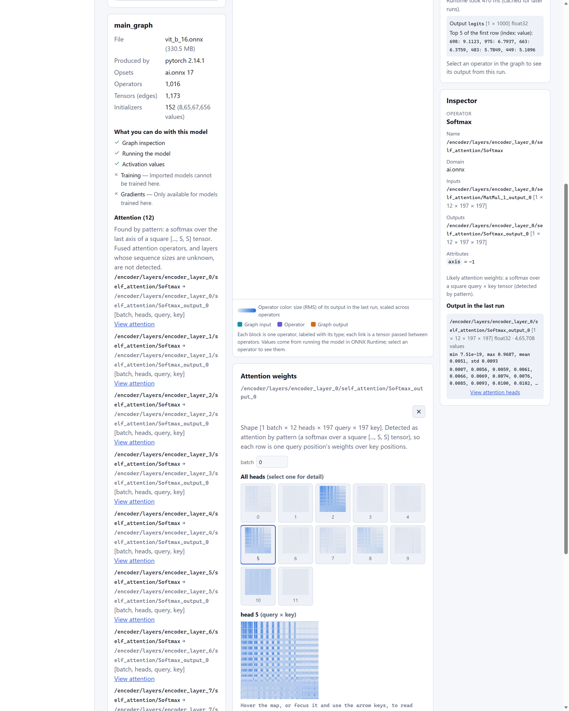

# NeuroVision

### Interactive 2D/3D neural-network visualization — build, train and look inside real models

[](frontend/)
[](backend/)
[](backend/app/ml/)
[](PLAN.md)

**NeuroVision** is a web platform for exploring neural networks visually. You can:

- design a small network and see it in synchronized **2D and 3D** views;
- train it and watch loss, accuracy and activations update **live**;
- import a real trained **ONNX** model and inspect its graph, weights and per-operator values, including CNN feature maps, convolution filters and attention heads.

Everything the UI shows as model behaviour comes from **actually computed values**, never from decorative animation.

> **Author:** K. Vishwa (Kokkireni Vishwa) — [vishwa-10147](https://github.com/vishwa-10147)
>
> 📄 **Paper:** [*NeuroVision: An Interactive Platform for Building, Training, and Inspecting Neural Networks with Measured Values in Synchronized 2D and 3D Views*](paper/NeuroVision_Paper.pdf) ([PDF](paper/NeuroVision_Paper.pdf) · [DOCX](paper/NeuroVision_Paper.docx)). It covers the design, architecture and an evaluation with measured results.

---

## Contents

- [Features](#features)
- [Architecture](#architecture)
- [Technology stack](#technology-stack)
- [Repository layout](#repository-layout)
- [Quick start (Windows PowerShell)](#quick-start-windows-powershell)
- [Watch your own PyTorch training live](#watch-your-own-pytorch-training-live)
- [More algorithms: Classical ML Lab and Neural Lab](#more-algorithms-classical-ml-lab-and-neural-lab)
- [Real vision models: benchmarks and views](#real-vision-models-benchmarks-and-views)
- [Implemented API](#implemented-api)
- [Quality checks](#quality-checks)
- [Documentation](#documentation)
- [Security](#security)
- [Roadmap and status](#roadmap-and-status)
- [Contributing](#contributing)
- [License](#license)

---

## Features

| Area | What you can do |
|---|---|
| **Architecture Studio** | Build a dense network within validated limits (ReLU / sigmoid / tanh). It is backed by a seeded PyTorch model and shown in switchable **2D and 3D** views with a synchronized inspector. Run a forward pass to shade units by their real computed values. The inspector shows real activations, weights, biases and gradients. |
| **Training Lab** | Train on deterministic *moons*, *circles* or *spiral* data in a background job. Loss and accuracy charts update live, activations stream over a **WebSocket**, and you can cancel a run. |
| **Model Explorer** | Import a trained **ONNX** model, either your own export from PyTorch or a built-in sample. Inspect its operator graph in 2D and 3D, its shapes and attributes, and its weights. **Run it** on inputs you choose in an isolated, time-limited ONNX Runtime worker to see real outputs and every operator's values. After a run you can view:<br>• CNN **feature maps** channel by channel<br>• **convolution filters**<br>• **attention heads** as query × key matrices. Attention is detected by pattern, and the UI labels it as such. |
| **Live Runs** | Stream metrics and chosen layer activations from **your own** training script, using a one-file Python SDK. The script runs on your machine; NeuroVision only receives the small values you log. |
| **Training health** | `HealthMonitor` measures, per layer, gradient and weight norms, update ratios ‖Δw‖/‖w‖, dead and saturated units, plus NaN/∞ gradients. The server turns them into **alerts**, for example exploding or vanishing gradients, dead ReLUs, NaN loss, loss spikes, plateaus and overfitting. Each alert quotes the measured numbers and gives advice. |
| **Run controls** | With `control=True`, you can **pause, resume, stop, save a checkpoint or change the learning rate** of your own script from the dashboard. The script applies each command in its training thread at `run.poll()` and reports *applied* or *rejected* with a reason. |
| **Dashboard** | Backend health check, plus the shared graph, event and error contracts. |

*Learning Mode* is shown in the UI as planned. The 3D view requires WebGL.

---

## Architecture



Both model sources, the educational networks and imported ONNX models, feed one **shared normalized graph model**. The 2D and 3D views render the same data, and the renderers never depend on PyTorch or ONNX internals. Large tensors are kept out of the graph JSON and are served as bounded summaries or slices.

See [`ARCHITECTURE.md`](ARCHITECTURE.md) for the full system design and [`docs/decisions/`](docs/decisions/) for why each piece was built the way it was.

---

## Technology stack

| Layer | Tools |
|---|---|
| Frontend | React, TypeScript (strict), Vite, React Three Fiber / Three.js, Zustand, Recharts, Zod, Vitest + Testing Library, oxlint |
| Backend | Python 3.12, FastAPI, Pydantic, Uvicorn, WebSockets |
| ML | PyTorch, NumPy, ONNX, ONNX Runtime (in an isolated worker process) |
| Quality | Pytest, HTTPX, Ruff |
| Contracts | JSON Schema in `shared/schemas/`, mirrored by Pydantic and Zod |

---

## Repository layout

```text
neurovision/
├── frontend/                 # React + TypeScript app (Vite)
│   └── src/
│       ├── features/         # architecture-studio, training-lab, model-import,
│       │                     # live-runs, visualization-2d, visualization-3d, dashboard, planned
│       ├── components/       # inspector, state views
│       ├── stores/  api/  types/  hooks/  lib/
│       └── test/
├── backend/                  # FastAPI service
│   ├── app/
│   │   ├── api/routes/       # REST + WebSocket endpoints
│   │   ├── ml/               # educational networks, datasets, trainer, ONNX worker + samples, tensor maps
│   │   ├── services/         # ONNX import/runtime, training jobs, event stream, external runs, tensors
│   │   ├── schemas/          # Pydantic models
│   │   └── core/             # config, errors
│   ├── tests/                # pytest suite (254 tests)
│   ├── requirements.txt  requirements-dev.txt  pyproject.toml
│   └── .env.example
├── sdk/
│   ├── neurovision_client.py # one-file client for streaming your own training
│   └── examples/train_spiral.py
├── bench/                    # Real-model benchmarks: vision_models.py, check_onnx.py, train_live.py, results/
├── shared/schemas/           # JSON Schemas for graph, events, errors, tensors (+ examples)
├── docs/                     # API reference, guides, design decisions (ADRs)
├── paper/                    # Technical paper (PDF + DOCX)
├── ARCHITECTURE.md           # System design and boundaries
├── PLAN.md                   # Milestones and acceptance criteria
├── SKILLS.md                 # Engineering standards and skills checklist
└── PROMPT.md                 # Master build prompt used to drive the implementation
```

---

## Quick start (Windows PowerShell)

These steps were verified on Windows 11 with the following versions:

| Tool | Version |
|---|---|
| Node.js | 24 |
| Python | 3.12.10 |
| PyTorch | 2.14.1, CPU build |
| onnx | 1.23.2 |
| onnxruntime | 1.31.0 |

**Prerequisites:**
- Git
- Node.js LTS and npm
- Python 3.12
- Optionally, an NVIDIA GPU with a matching PyTorch CUDA build

### 1. Backend

From the repository root:

```powershell
cd backend
py -3.12 -m venv .venv
.\.venv\Scripts\Activate.ps1
python -m pip install --upgrade pip
pip install --index-url https://download.pytorch.org/whl/cpu torch==2.14.1
pip install -r requirements-dev.txt
```

The CPU build is enough for the educational networks, where each training run takes seconds. For a GPU build, use the matching command from <https://pytorch.org/get-started/locally/> instead. `requirements.txt` pins `torch==2.14.1`, which local builds such as `2.14.1+cpu` satisfy.

### 2. Frontend

From the repository root:

```powershell
cd frontend
npm install
```

### 3. Run

```powershell
# Terminal A — backend
cd backend; .\.venv\Scripts\Activate.ps1
uvicorn app.main:app --reload --port 8000
```

```powershell
# Terminal B — frontend
cd frontend
npm run dev
```

| URL | What |
|---|---|
| <http://localhost:5173> | NeuroVision app |
| <http://localhost:8000/api/v1/health> | Health endpoint |
| <http://localhost:8000/docs> | Interactive FastAPI docs |

The dashboard shows **Backend online** with the service version when the health check succeeds. If the check fails or doesn't answer within 5 seconds, it shows an error with startup instructions instead. It re-checks every 15 seconds.

### Using other ports

The two services find each other through environment variables; see `backend/.env.example` and `frontend/.env.example`.

```powershell
# backend/ on 8001, allowing a frontend on 5174
$env:NEUROVISION_CORS_ORIGINS = "http://localhost:5174"
uvicorn app.main:app --reload --port 8001
```

```powershell
# frontend/ on 5174, talking to the backend on 8001
$env:VITE_API_BASE_URL = "http://localhost:8001"
npm run dev -- --port 5174
```

### Verify PyTorch

```powershell
python -c "import torch; print('PyTorch:', torch.__version__); print('CUDA available:', torch.cuda.is_available())"
```

---

## Watch your own PyTorch training live

Copy [`sdk/neurovision_client.py`](sdk/neurovision_client.py) next to your training script. It uses only the standard library, plus PyTorch for `ActivationProbe`. Then open **Live runs** in the browser:

```python
import neurovision_client as nv

run = nv.start_run("resnet18 / lr 3e-4", total_epochs=20, url="http://127.0.0.1:8000")
probe = nv.ActivationProbe(model, {"avgpool": model.avgpool},
                           probe_batch=next(iter(val_loader))[0][:1].to(device))

with run:                                   # marks the run failed on an exception
    for epoch in range(1, 21):
        loss, acc = train_one_epoch(model, train_loader)
        run.log(epoch=epoch, metrics={"loss": loss, "accuracy": acc},
                activations=probe.capture())
```

### Health alerts and control from the dashboard

```python
monitor = nv.HealthMonitor(model, optimizer=optimizer, probe_batch=x_val[:64])

with nv.start_run("resnet18", total_epochs=20, control=True,
                  optimizer=optimizer, on_checkpoint=save_checkpoint) as run:
    for epoch in range(1, 21):
        for xb, yb in train_loader:
            if not run.poll():          # applies Pause/Stop/LR/Checkpoint; blocks while paused
                break
            ...                         # forward, backward, optimizer.step()
        if run.should_stop:
            break
        run.log(epoch=epoch, metrics={"loss": loss, "val_loss": val_loss},
                health=monitor.collect())
```

Controls are off unless you pass `control=True`. Anyone who can reach the backend can send commands to a run that opted in, so keep the backend on localhost or a trusted network.

A complete example is in [`sdk/examples/train_spiral.py`](sdk/examples/train_spiral.py). Run it with `--lr 0.5` to watch the alerts fire. The full guide is [`docs/live-runs.md`](docs/live-runs.md).

> **Tip:** on Windows, use `127.0.0.1` rather than `localhost`. Otherwise each request can take about 2 s because Windows tries IPv6 first.

### See the network while it trains

Pass `model=model, example_input=x[:1]` to `start_run` and Live Runs shows the network's graph in 2D and 3D, colored every step by activation size, gradient norm or dead units. Four ready demos (MLP, CNN, self-attention, autoencoder) are in [`sdk/examples`](sdk/examples/README.md); which models are supported where is in [`docs/supported-models.md`](docs/supported-models.md).



### System use, speed and ETA

Every logged step also carries elapsed time, step time, an ETA, throughput (`samples=`), CPU and RAM (with `psutil`), and per-GPU load, memory, temperature and power (with `nvidia-ml-py`), shown in a **System & speed** panel with charts. Two rules flag an idle GPU and nearly full GPU memory.

## More algorithms: Classical ML Lab and Neural Lab

-   **Classical ML** fits nine scikit-learn algorithms (logistic regression, linear and RBF SVMs, k-NN, decision tree, random forest, gradient boosting, k-Means, PCA) and animates how they decide: decision regions over epochs, trees, k or iterations, plus the fitted tree, support vectors, centroids or principal components. [Guide](docs/classical-ml.md).
-   **Neural Lab** configures and trains built-in PyTorch models live: MLP, CNN, LSTM/GRU/RNN, transformer, autoencoder, VAE, GAN, graph neural network, diffusion model and reinforcement learning (CartPole). Each streams to Live Runs with its graph, health, CPU/GPU/ETA and its own visuals (latent spaces, generated digits, hidden states, embeddings). [Guide](docs/neural-lab.md).
-   **scikit-learn models** exported with skl2onnx import and run in the Model Explorer, with a tree view for forests and boosting.

| | |
|---|---|
|  |  |

## Real vision models: benchmarks and views

[`docs/vision-benchmarks.md`](docs/vision-benchmarks.md) measures seven pretrained torchvision models on an RTX 4070 Laptop GPU, from MobileNetV3 to ViT-B/16 and the 3D video CNN R3D-18: speed, GPU/CPU load, memory, ONNX export accuracy, predictions on real photos, 2D/3D views, feature maps and attention, and live GPU fine-tuning with ETA and system telemetry.

| Model | Params | GPU b1 | GPU throughput (fp16) | ONNX Runtime CPU b1 | Fine-tuned test acc. (digits) |
|---|---:|---:|---:|---:|---:|
| MobileNetV3-Large | 5.5 M | 6.1 ms | 3,531 /s | 1.8 ms | 98.6 %¹ |
| ResNet-50 | 25.6 M | 6.5 ms | 869 /s | 12.0 ms | 99.4 % |
| ConvNeXt-Tiny | 28.6 M | 4.5 ms | 752 /s | 34.7 ms | 99.4 % |
| ViT-B/16 | 86.6 M | 9.6 ms | 401 /s | 108 ms | 99.7 % |

¹ After raising its BatchNorm momentum; with torchvision's 0.01 it tested at 52.5 % (see the doc).



---

## Implemented API

| Endpoint | Purpose |
|---|---|
| `GET /api/v1/health` | Service health |
| `POST /api/v1/models/educational` | Validate a dense-network config and build its graph |
| `GET /api/v1/models/{model_id}/graph` | A created model's normalized graph |
| `POST /api/v1/models/{model_id}/forward` | Forward pass with every layer's real values |
| `GET /api/v1/models/{model_id}/tensors/{tensor_id}` | Bounded weights, biases, gradients |
| `POST /api/v1/models/{model_id}/training` | Start a background training job |
| `GET /api/v1/models/{model_id}/metrics` | Latest job and per-epoch metrics |
| `GET /api/v1/training/{job_id}` | Job status |
| `POST /api/v1/training/{job_id}/cancel` | Cancel a job |
| `WS /api/v1/training/{job_id}/events` | Replayed + live training events (jobs and external runs) |
| `POST /api/v1/runs` | Start an external run from your own script |
| `POST /api/v1/runs/{run_id}/events` | Log a batch of steps (write token required) |
| `POST /api/v1/runs/{run_id}/finish` | Mark an external run completed or failed |
| `GET /api/v1/runs` | List external runs |
| `POST /api/v1/runs/{run_id}/commands` | Pause, resume, stop, checkpoint or set the learning rate of a run that opted in |
| `GET /api/v1/runs/{run_id}/commands` | Pending commands, for the script (write token required) |
| `POST /api/v1/runs/{run_id}/commands/{command_id}/ack` | The script reports a command as applied or rejected |
| `POST /api/v1/import/onnx?filename=…` | Import an ONNX file (raw body) for inspection |
| `GET /api/v1/import/onnx/samples` | List built-in sample models |
| `POST /api/v1/import/onnx/samples/{name}` | Import a sample model |
| `POST /api/v1/models/{model_id}/run` | Run an imported model in the isolated worker |
| `GET /api/v1/models/{model_id}/maps` | One bounded 2D map of a tensor from a recent run |
| `GET /api/v1/models/{model_id}/grids` | Channel or head thumbnails from a recent run |

All errors use one envelope: `{"error": {"code", "message", "details"}}`.

[`docs/api.md`](docs/api.md) covers the request and response details, the limits, and the fact that storage is currently in memory only.

**API conventions:**
- Versioned REST lives under `/api/v1`.
- Pydantic validates requests and responses.
- WebSockets carry compact training events.
- Large tensors are served only as bounded summaries or slices.

---

## Quality checks

```powershell
# backend/ (venv active)
pytest
ruff check .
ruff format --check .
```

```powershell
# frontend/
npm run lint        # oxlint
npm run typecheck   # tsc -b, strict
npm test            # Vitest + Testing Library
npm run build
```

---

## Documentation

| Document | Contents |
|---|---|
| [`paper/NeuroVision_Paper.pdf`](paper/NeuroVision_Paper.pdf) · [`.docx`](paper/NeuroVision_Paper.docx) | Technical paper: motivation, related work, design, architecture, evaluation (tests, correctness, training, latency, limits) |
| [`docs/README.md`](docs/README.md) | Documentation index |
| [`ARCHITECTURE.md`](ARCHITECTURE.md) | System design, component boundaries, data contracts |
| [`docs/api.md`](docs/api.md) | REST and WebSocket API reference, limits |
| [`docs/schemas.md`](docs/schemas.md) | Graph, event, error and health contracts; keeping Pydantic, JSON Schema and Zod in sync |
| [`docs/importing-onnx.md`](docs/importing-onnx.md) | Exporting from PyTorch and importing, inspecting and running ONNX models |
| [`docs/live-runs.md`](docs/live-runs.md) | Streaming your own training with the SDK |
| [`docs/classical-ml.md`](docs/classical-ml.md) | Classical ML Lab: nine scikit-learn algorithms, animated |
| [`docs/neural-lab.md`](docs/neural-lab.md) | Neural Lab: configure and train ten model families live |
| [`docs/supported-models.md`](docs/supported-models.md) | Which models work in the Studio, the Model Explorer and Live Runs; linking a run to its graph |
| [`docs/vision-benchmarks.md`](docs/vision-benchmarks.md) | Seven real vision models: speed, load, accuracy, 2D/3D views, attention, GPU fine-tuning |
| [`docs/decisions/`](docs/decisions/) | Architecture decision records (0001–0010) |
| [`PLAN.md`](PLAN.md) | Milestones and acceptance criteria |
| [`SKILLS.md`](SKILLS.md) | Engineering standards and skills checklist |

---

## Security

- Model uploads are treated as **untrusted**.
- Upload and tensor-request sizes are limited.
- Pickle files and other unsafe serialized Python objects are **never** loaded.
- Imported models are never executed automatically on upload. Running one is an explicit action, and it happens in an **isolated, time-limited** worker process.
- Secrets stay out of source control; see the `.env.example` files.
- CORS is configured explicitly. By default only `http://localhost:5173` and `http://127.0.0.1:5173` are allowed, and `NEUROVISION_CORS_ORIGINS` overrides this.

---

## Roadmap and status

The project is built milestone by milestone, and each milestone leaves the repository runnable and tested:

| Milestone | Scope | Status |
|---|---|---|
| 0 | Scaffold frontend and backend, health check | ✅ |
| 1 | Shared graph/event contracts, error envelope, state views | ✅ |
| 2 | Architecture Studio with 2D renderer and inspector | ✅ |
| 3 | 3D explorer with synced selection and detail limits | ✅ |
| 4 | PyTorch training, forward passes, live event streaming | ✅ |
| 5 | Safe ONNX import and graph inspection | ✅ |
| 6 | Run imported models; stream your own training (Live Runs) | ✅ |
| 7 | CNN feature maps, attention heads, filter views | ✅ |
| — | Training health alerts and two-way run controls ([ADR 0008](docs/decisions/0008-run-health-and-controls.md)) | ✅ |
| — | Classical ML Lab (9 algorithms), Neural Lab (10 model families), custom visuals in Live Runs, scikit-learn models with tree view ([ADR 0010](docs/decisions/0010-more-algorithms.md)) | ✅ |
| — | Live network graph for live runs (2D/3D, colored by activations, gradients or dead units) and demo set: MLP, CNN, self-attention, autoencoder ([ADR 0009](docs/decisions/0009-live-run-graphs.md)) | ✅ |
| — | System and GPU telemetry with ETA in Live Runs; heavy-model support in the Model Explorer (wrapped 2D/3D layouts, photo inputs, capture on request, per-map contrast, video tensors) and [benchmarks](docs/vision-benchmarks.md) | ✅ |
| Next | Learning Mode, saved projects, deployment | planned |

See [`PLAN.md`](PLAN.md) for the detailed tasks and acceptance criteria.

**Development principles:**
- Build one vertical slice at a time.
- Use one shared graph schema for every view.
- Keep measured values clearly separate from explanatory animation.
- Test numerical correctness, API validation and renderer synchronization.
- Document only behaviour that exists.

---

## Contributing

- Create a focused branch for each feature, and keep pull requests small and testable.
- Include tests for bug fixes and numerical logic.
- Before merging, run formatting, linting, type checks, tests and a production build.
- Document limitations and intentional trade-offs.

---

## License

No license has been chosen yet. Until a `LICENSE` file is added, all rights are reserved by the author.
