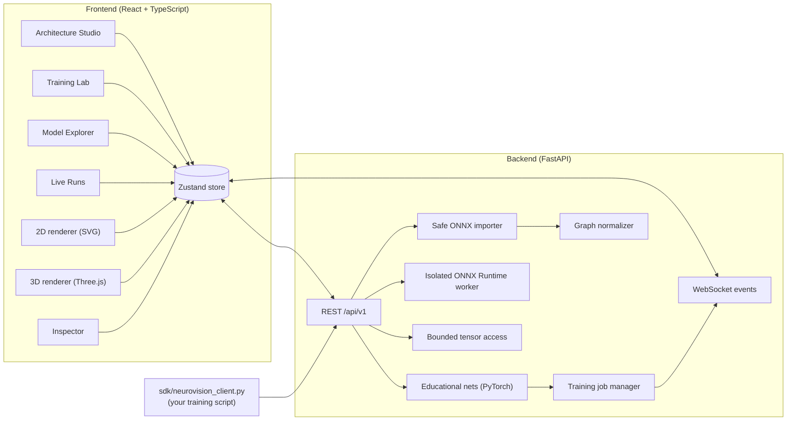

# NeuroVision

### Interactive 2D/3D neural-network visualization — build, train and look inside real models

[](frontend/)
[](backend/)
[](backend/app/ml/)
[](PLAN.md)

**NeuroVision** is a web platform for exploring neural networks visually. You can:

- design a small network and see it in synchronized **2D and 3D** views;
- train it and watch loss, accuracy and activations update **live**;
- import a real trained **ONNX** model and inspect its graph, weights and per-operator values, including CNN feature maps, convolution filters and attention heads.

Everything the UI shows as model behaviour comes from **actually computed values**, never from decorative animation.

> **Author:** K. Vishwa (Kokkireni Vishwa) — [vishwa-10147](https://github.com/vishwa-10147)

---

## Contents

- [Features](#features)
- [Architecture](#architecture)
- [Technology stack](#technology-stack)
- [Repository layout](#repository-layout)
- [Quick start (Windows PowerShell)](#quick-start-windows-powershell)
- [Watch your own PyTorch training live](#watch-your-own-pytorch-training-live)
- [Implemented API](#implemented-api)
- [Quality checks](#quality-checks)
- [Documentation](#documentation)
- [Security](#security)
- [Roadmap and status](#roadmap-and-status)
- [Contributing](#contributing)
- [License](#license)

---

## Features

| Area | What you can do |
|---|---|
| **Architecture Studio** | Build a dense network within validated limits (ReLU / sigmoid / tanh). It is backed by a seeded PyTorch model and shown in switchable **2D and 3D** views with a synchronized inspector. Run a forward pass to shade units by their real computed values. The inspector shows real activations, weights, biases and gradients. |
| **Training Lab** | Train on deterministic *moons*, *circles* or *spiral* data in a background job. Loss and accuracy charts update live, activations stream over a **WebSocket**, and you can cancel a run. |
| **Model Explorer** | Import a trained **ONNX** model, either your own export from PyTorch or a built-in sample. Inspect its operator graph in 2D and 3D, its shapes and attributes, and its weights. **Run it** on inputs you choose in an isolated, time-limited ONNX Runtime worker to see real outputs and every operator's values. After a run you can view:<br>• CNN **feature maps** channel by channel<br>• **convolution filters**<br>• **attention heads** as query × key matrices. Attention is detected by pattern, and the UI labels it as such. |
| **Live Runs** | Stream metrics and chosen layer activations from **your own** training script, using a one-file Python SDK. The script runs on your machine; NeuroVision only receives the small values you log. |
| **Dashboard** | Backend health check, plus the shared graph, event and error contracts. |

*Learning Mode* is shown in the UI as planned. The 3D view requires WebGL.

---

## Architecture



Both model sources, the educational networks and imported ONNX models, feed one **shared normalized graph model**. The 2D and 3D views render the same data, and the renderers never depend on PyTorch or ONNX internals. Large tensors are kept out of the graph JSON and are served as bounded summaries or slices.

See [`ARCHITECTURE.md`](ARCHITECTURE.md) for the full system design and [`docs/decisions/`](docs/decisions/) for why each piece was built the way it was.

---

## Technology stack

| Layer | Tools |
|---|---|
| Frontend | React, TypeScript (strict), Vite, React Three Fiber / Three.js, Zustand, Recharts, Zod, Vitest + Testing Library, oxlint |
| Backend | Python 3.12, FastAPI, Pydantic, Uvicorn, WebSockets |
| ML | PyTorch, NumPy, ONNX, ONNX Runtime (in an isolated worker process) |
| Quality | Pytest, HTTPX, Ruff |
| Contracts | JSON Schema in `shared/schemas/`, mirrored by Pydantic and Zod |

---

## Repository layout

```text
neurovision/
├── frontend/                 # React + TypeScript app (Vite)
│   └── src/
│       ├── features/         # architecture-studio, training-lab, model-import,
│       │                     # live-runs, visualization-2d, visualization-3d, dashboard, planned
│       ├── components/       # inspector, state views
│       ├── stores/  api/  types/  hooks/  lib/
│       └── test/
├── backend/                  # FastAPI service
│   ├── app/
│   │   ├── api/routes/       # REST + WebSocket endpoints
│   │   ├── ml/               # PyTorch educational networks, training
│   │   ├── services/         # ONNX importer, ONNX Runtime worker, jobs, runs, tensor views
│   │   ├── schemas/          # Pydantic models
│   │   └── core/             # config, errors
│   ├── tests/                # pytest suite (147 tests)
│   ├── requirements.txt  requirements-dev.txt  pyproject.toml
│   └── .env.example
├── sdk/
│   ├── neurovision_client.py # one-file client for streaming your own training
│   └── examples/train_spiral.py
├── shared/schemas/           # JSON Schemas for graph, events, errors, tensors (+ examples)
├── docs/                     # API reference, guides, design decisions (ADRs)
├── ARCHITECTURE.md           # System design and boundaries
├── PLAN.md                   # Milestones and acceptance criteria
├── SKILLS.md                 # Engineering standards and skills checklist
└── PROMPT.md                 # Master build prompt used to drive the implementation
```

---

## Quick start (Windows PowerShell)

These steps were verified on Windows 11 with the following versions:

| Tool | Version |
|---|---|
| Node.js | 24 |
| Python | 3.12.10 |
| PyTorch | 2.14.1, CPU build |
| onnx | 1.23.2 |
| onnxruntime | 1.31.0 |

**Prerequisites:**
- Git
- Node.js LTS and npm
- Python 3.12
- Optionally, an NVIDIA GPU with a matching PyTorch CUDA build

### 1. Backend

From the repository root:

```powershell
cd backend
py -3.12 -m venv .venv
.\.venv\Scripts\Activate.ps1
python -m pip install --upgrade pip
pip install --index-url https://download.pytorch.org/whl/cpu torch==2.14.1
pip install -r requirements-dev.txt
```

The CPU build is enough for the educational networks, where each training run takes seconds. For a GPU build, use the matching command from <https://pytorch.org/get-started/locally/> instead. `requirements.txt` pins `torch==2.14.1`, which local builds such as `2.14.1+cpu` satisfy.

### 2. Frontend

From the repository root:

```powershell
cd frontend
npm install
```

### 3. Run

```powershell
# Terminal A — backend
cd backend; .\.venv\Scripts\Activate.ps1
uvicorn app.main:app --reload --port 8000
```

```powershell
# Terminal B — frontend
cd frontend
npm run dev
```

| URL | What |
|---|---|
| <http://localhost:5173> | NeuroVision app |
| <http://localhost:8000/api/v1/health> | Health endpoint |
| <http://localhost:8000/docs> | Interactive FastAPI docs |

The dashboard shows **Backend online** with the service version when the health check succeeds. If the check fails or doesn't answer within 5 seconds, it shows an error with startup instructions instead. It re-checks every 15 seconds.

### Using other ports

The two services find each other through environment variables; see `backend/.env.example` and `frontend/.env.example`.

```powershell
# backend/ on 8001, allowing a frontend on 5174
$env:NEUROVISION_CORS_ORIGINS = "http://localhost:5174"
uvicorn app.main:app --reload --port 8001
```

```powershell
# frontend/ on 5174, talking to the backend on 8001
$env:VITE_API_BASE_URL = "http://localhost:8001"
npm run dev -- --port 5174
```

### Verify PyTorch

```powershell
python -c "import torch; print('PyTorch:', torch.__version__); print('CUDA available:', torch.cuda.is_available())"
```

---

## Watch your own PyTorch training live

Copy [`sdk/neurovision_client.py`](sdk/neurovision_client.py) next to your training script. It uses only the standard library, plus PyTorch for `ActivationProbe`. Then open **Live runs** in the browser:

```python
import neurovision_client as nv

run = nv.start_run("resnet18 / lr 3e-4", total_epochs=20, url="http://127.0.0.1:8000")
probe = nv.ActivationProbe(model, {"avgpool": model.avgpool},
                           probe_batch=next(iter(val_loader))[0][:1].to(device))

with run:                                   # marks the run failed on an exception
    for epoch in range(1, 21):
        loss, acc = train_one_epoch(model, train_loader)
        run.log(epoch=epoch, metrics={"loss": loss, "accuracy": acc},
                activations=probe.capture())
```

A complete example is in [`sdk/examples/train_spiral.py`](sdk/examples/train_spiral.py), and the full guide is [`docs/live-runs.md`](docs/live-runs.md).

> **Tip:** on Windows, use `127.0.0.1` rather than `localhost`. Otherwise each request can take about 2 s because Windows tries IPv6 first.

---

## Implemented API

| Endpoint | Purpose |
|---|---|
| `GET /api/v1/health` | Service health |
| `POST /api/v1/models/educational` | Validate a dense-network config and build its graph |
| `GET /api/v1/models/{model_id}/graph` | A created model's normalized graph |
| `POST /api/v1/models/{model_id}/forward` | Forward pass with every layer's real values |
| `GET /api/v1/models/{model_id}/tensors/{tensor_id}` | Bounded weights, biases, gradients |
| `POST /api/v1/models/{model_id}/training` | Start a background training job |
| `GET /api/v1/models/{model_id}/metrics` | Latest job and per-epoch metrics |
| `GET /api/v1/training/{job_id}` | Job status |
| `POST /api/v1/training/{job_id}/cancel` | Cancel a job |
| `WS /api/v1/training/{job_id}/events` | Replayed + live training events (jobs and external runs) |
| `POST /api/v1/runs` | Start an external run from your own script |
| `POST /api/v1/runs/{run_id}/events` | Log a batch of steps (write token required) |
| `POST /api/v1/runs/{run_id}/finish` | Mark an external run completed or failed |
| `GET /api/v1/runs` | List external runs |
| `POST /api/v1/import/onnx?filename=…` | Import an ONNX file (raw body) for inspection |
| `GET /api/v1/import/onnx/samples` | List built-in sample models |
| `POST /api/v1/import/onnx/samples/{name}` | Import a sample model |
| `POST /api/v1/models/{model_id}/run` | Run an imported model in the isolated worker |
| `GET /api/v1/models/{model_id}/maps` | One bounded 2D map of a tensor from a recent run |
| `GET /api/v1/models/{model_id}/grids` | Channel or head thumbnails from a recent run |

All errors use one envelope: `{"error": {"code", "message", "details"}}`.

[`docs/api.md`](docs/api.md) covers the request and response details, the limits, and the fact that storage is currently in memory only.

**API conventions:**
- Versioned REST lives under `/api/v1`.
- Pydantic validates requests and responses.
- WebSockets carry compact training events.
- Large tensors are served only as bounded summaries or slices.

---

## Quality checks

```powershell
# backend/ (venv active)
pytest
ruff check .
ruff format --check .
```

```powershell
# frontend/
npm run lint        # oxlint
npm run typecheck   # tsc -b, strict
npm test            # Vitest + Testing Library
npm run build
```

---

## Documentation

| Document | Contents |
|---|---|
| [`docs/README.md`](docs/README.md) | Documentation index |
| [`ARCHITECTURE.md`](ARCHITECTURE.md) | System design, component boundaries, data contracts |
| [`docs/api.md`](docs/api.md) | REST and WebSocket API reference, limits |
| [`docs/schemas.md`](docs/schemas.md) | Graph, event, error and health contracts; keeping Pydantic, JSON Schema and Zod in sync |
| [`docs/importing-onnx.md`](docs/importing-onnx.md) | Exporting from PyTorch and importing, inspecting and running ONNX models |
| [`docs/live-runs.md`](docs/live-runs.md) | Streaming your own training with the SDK |
| [`docs/decisions/`](docs/decisions/) | Architecture decision records (0001–0007) |
| [`PLAN.md`](PLAN.md) | Milestones and acceptance criteria |
| [`SKILLS.md`](SKILLS.md) | Engineering standards and skills checklist |

---

## Security

- Model uploads are treated as **untrusted**.
- Upload and tensor-request sizes are limited.
- Pickle files and other unsafe serialized Python objects are **never** loaded.
- Imported models are never executed automatically on upload. Running one is an explicit action, and it happens in an **isolated, time-limited** worker process.
- Secrets stay out of source control; see the `.env.example` files.
- CORS is configured explicitly. By default only `http://localhost:5173` and `http://127.0.0.1:5173` are allowed, and `NEUROVISION_CORS_ORIGINS` overrides this.

---

## Roadmap and status

The project is built milestone by milestone, and each milestone leaves the repository runnable and tested:

| Milestone | Scope | Status |
|---|---|---|
| 0 | Scaffold frontend and backend, health check | ✅ |
| 1 | Shared graph/event contracts, error envelope, state views | ✅ |
| 2 | Architecture Studio with 2D renderer and inspector | ✅ |
| 3 | 3D explorer with synced selection and detail limits | ✅ |
| 4 | PyTorch training, forward passes, live event streaming | ✅ |
| 5 | Safe ONNX import and graph inspection | ✅ |
| 6 | Run imported models; stream your own training (Live Runs) | ✅ |
| 7 | CNN feature maps, attention heads, filter views | ✅ |
| Next | Learning Mode, saved projects, deployment | planned |

See [`PLAN.md`](PLAN.md) for the detailed tasks and acceptance criteria.

**Development principles:**
- Build one vertical slice at a time.
- Use one shared graph schema for every view.
- Keep measured values clearly separate from explanatory animation.
- Test numerical correctness, API validation and renderer synchronization.
- Document only behaviour that exists.

---

## Contributing

- Create a focused branch for each feature, and keep pull requests small and testable.
- Include tests for bug fixes and numerical logic.
- Before merging, run formatting, linting, type checks, tests and a production build.
- Document limitations and intentional trade-offs.

---

## License

No license has been chosen yet. Until a `LICENSE` file is added, all rights are reserved by the author.
