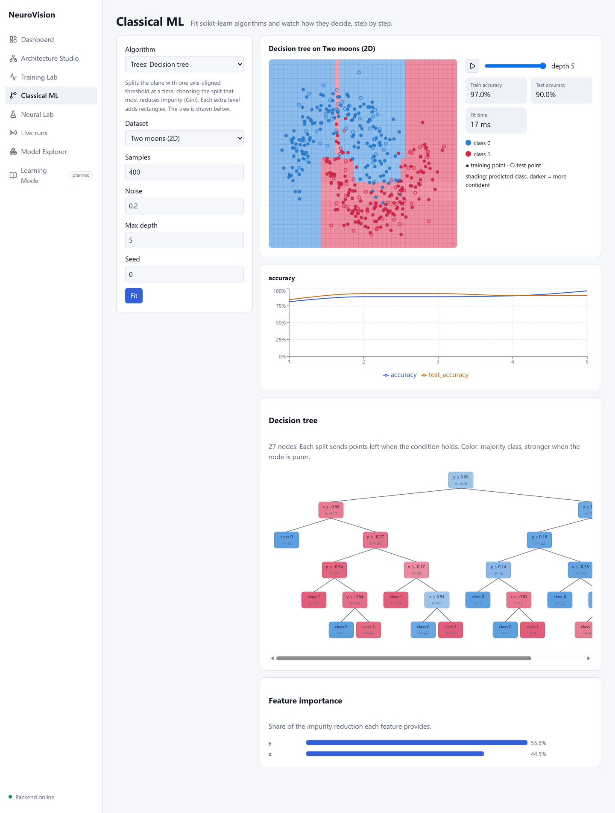
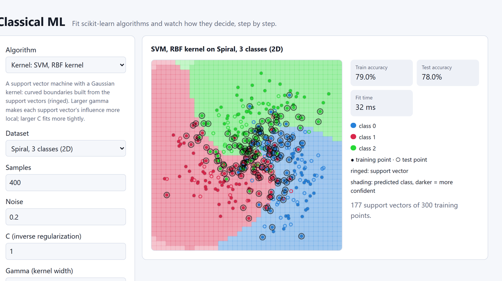
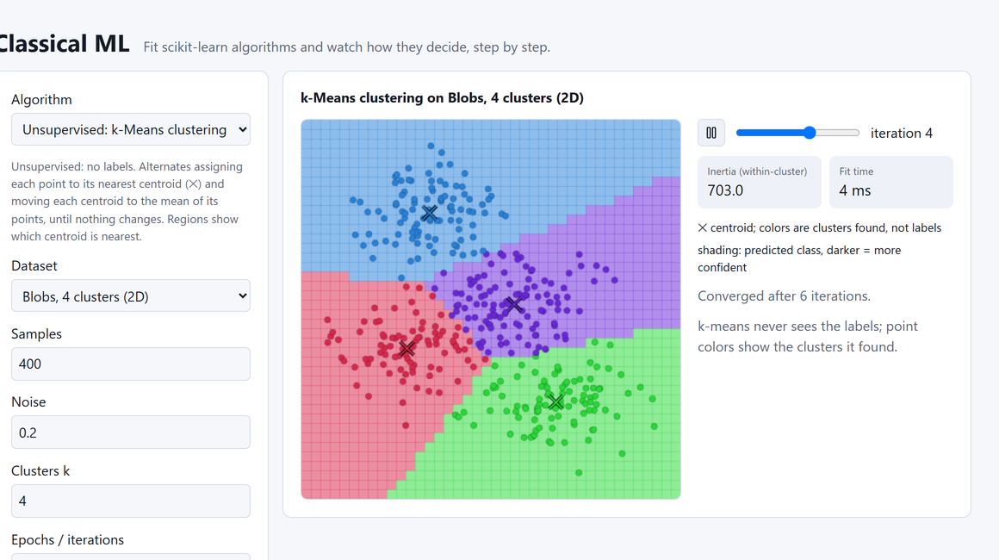
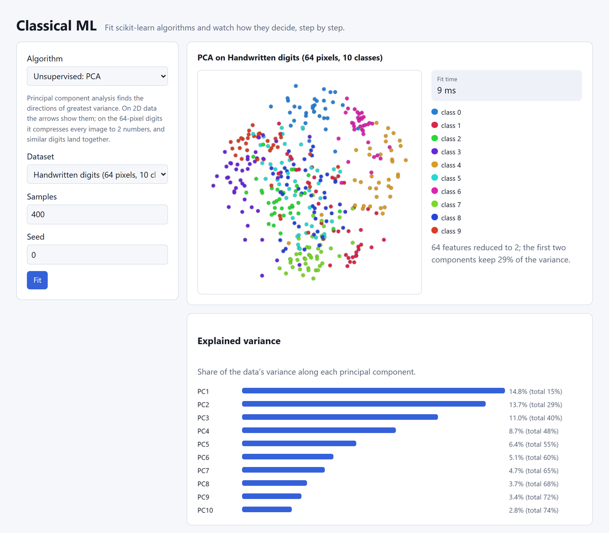

# Classical ML Lab

**Classical ML** in the sidebar fits a scikit-learn algorithm on a small
dataset on the backend and shows how it decides: decision regions, the
points, an animation of how the model got there, and the model's own
structure. Every region, tree, support vector and centroid comes from the
fitted model; nothing is drawn by hand.

## Algorithms

| Family | Algorithm | Parameters | The animation steps through | Also shown |
|---|---|---|---|---|
| Linear | Logistic regression | C, epochs | training epochs (SGD, log loss) | predicted probability as shading |
| Linear | Linear SVM | C, epochs | training epochs (SGD, hinge loss) | predicted class |
| Kernel | SVM, RBF kernel | C, gamma | – | support vectors (ringed) |
| Instance-based | k-nearest neighbors | k | k = 1, 2, … (odd steps above 10) | – |
| Trees | Decision tree | max depth | depth 1 … max depth | the tree, feature importance |
| Trees | Random forest | trees, max depth | the first n trees averaged | first tree, feature importance |
| Trees | Gradient boosting | trees, learning rate, max depth | boosting stages | feature importance |
| Unsupervised | k-Means | clusters, iterations | Lloyd iterations to convergence | centroids (✕), inertia |
| Unsupervised | PCA | – | – | principal axes (2D) or a 2D projection, explained variance |

Datasets: **moons**, **circles**, **spiral** (3 classes), **blobs**
(4 clusters), all generated from a seed, and **digits**: scikit-learn's
1,797 real 8×8 handwritten digits (64 features, 10 classes). Digits work
with logistic regression, k-NN and random forest (scores only; there is no
2D plane to draw) and with PCA (projected to 2D).

## What you see

-   **Regions:** a 40 × 40 grid over the data, colored by the predicted
    class, darker where the model is more confident (its predicted
    probability; 1 for models without probabilities).
-   **Points:** filled = training, hollow = held out (25 % by default).
-   **Scores:** train and test accuracy at the current animation step,
    and an accuracy chart over all steps; fit time.
-   **Tree:** each split ("x ≤ 0.53") sends points left when it holds;
    nodes show the samples reaching them and are colored by their majority
    class, stronger when purer. Hover for the Gini impurity and class
    counts. Up to 127 nodes are drawn.

| | |
|---|---|
|  |  |
|  |  |

## Things to try

-   **Underfitting vs overfitting:** decision tree depth 1 → 12 on the
    spiral: train accuracy 57 % → 99 %, test only 43 % → 70 %. k-NN at
    k = 1 scores 100 % on the training points; compare its test score
    with k = 50 (76 %).
-   **Linear limits:** logistic regression on circles stays near chance
    (44 % test): no straight line separates rings. An RBF SVM reaches
    91 %.
-   **Kernel width:** compare the RBF SVM's boundary at gamma 0.1 and
    20 on the spiral, and the number of support vectors under the plot
    (229 and 213 of 300 here).
-   **Ensembles:** play a random forest and watch one tree's rectangles
    smooth out as trees are averaged.
-   **No labels:** k-Means with 2 clusters on moons (noise 0.1) agrees
    with the true moons on only 73 % of points: it cuts the plane into
    two halves by distance, while each moon curls around the other.
-   **Compression:** PCA keeps 29 % of the digits' variance in 2D, yet
    zeros, fours and sixes already form their own groups.

## API

`POST /api/v1/classical/fit` with the algorithm, dataset and parameters
(see [api.md](api.md)); every number is bounded (≤ 2,000 samples, ≤ 200
trees or epochs, depth ≤ 12). A fit takes 4–400 ms; responses carry at
most 40 frames.
