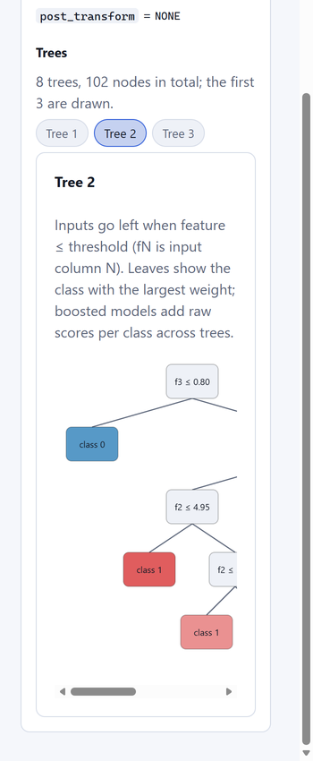

# Inspecting and running your own models (ONNX)

The **Model Explorer** opens trained models from real projects. It shows
their computation graph, operators, tensor shapes, and weights, and it
can **run** them on inputs you choose, showing the values every operator
actually produces. Runs happen in ONNX Runtime inside a separate,
time-limited worker process on the server; uploading never runs a model
by itself.

## Export a model from your project

### PyTorch

``` python
import torch

model.eval()                                   # your trained nn.Module
example = torch.randn(1, 3, 224, 224)          # one input of the right shape
torch.onnx.export(
    model, example, "my_model.onnx",
    input_names=["input"], output_names=["output"],
    dynamic_axes={"input": {0: "batch"}, "output": {0: "batch"}},
    opset_version=17,
    dynamo=False,  # classic exporter; needs only the onnx package
)
```

Verified with PyTorch 2.14.1 on a small residual CNN: module names such
as `/block1/conv1/Conv` appear in the graph, the dynamic `batch`
dimension is kept, and both skip connections show up as two links into
each `Add`. In eval mode the exporter folds BatchNorm into the preceding
convolutions, so the graph shows the folded weights, which is what the
file contains.

### scikit-learn

``` python
from skl2onnx import to_onnx

onnx_model = to_onnx(fitted_model, X_train[:1].astype("float32"),
                     options={"zipmap": False})   # probabilities as a tensor
open("model.onnx", "wb").write(onnx_model.SerializeToString())
```

Verified with decision trees, random forests, gradient boosting, logistic
regression (with a scaler), SVMs and k-NN on iris: they import, run in
ONNX Runtime, and their labels and probabilities match scikit-learn's.
Tree models (`TreeEnsembleClassifier` / `Regressor`) show their trees in
the inspector: the first three, up to 127 nodes each, with `fN ≤ t`
splits on input column N and leaves colored by class. Without
`zipmap=False`, probabilities come back as a list of maps per row
(ZipMap); NeuroVision converts them to a `[batch, classes]` tensor and
says so in the run notes.



### TensorFlow / Keras

Use [`tf2onnx`](https://github.com/onnx/tensorflow-onnx). The resulting
files import the same way. (This converter was not part of the
verification above.)

## What you see

-   **Graph:** one block per operator, labeled with its type (`Conv`,
    `Relu`, `Add`, …), plus blocks for graph inputs and outputs. Links are
    the tensors passed between operators. 2D and 3D views share the
    selection. Chains longer than 32 operators wrap into rows (left to
    right, then right to left; in 3D the rows are laid out in depth), so
    a ResNet-50 or ViT fits the screen; constants and weight arithmetic
    are placed just before the operator that uses them.
-   **Import report:** file, producer, opsets, operator / tensor /
    initializer counts, what you can and cannot do with the model, and
    warnings.
-   **Inspector:** the operator's name (your module path), domain,
    inputs and outputs with shapes, attributes, and its weight tensors.
    **Show values** loads a bounded summary (min, max, mean, std) and the
    first values; selecting a link shows the tensor's name and shape.

## Running a model

The **Run the model** panel lists each input the model declares, with
its type and shape:

-   Fixed dimensions (e.g. `3 × 32 × 32`) are locked. Named or unknown
    ones (e.g. `batch`) default to 1 and can be changed.
-   Values can be random (seeded, so repeatable), zeros, ones, evenly
    spaced from −1 to 1, or typed in (up to 4,096 values).
-   Image inputs (`[batch, 1 or 3, height, width]`) can also take a
    **Photo**: it is decoded in the browser, scaled to cover the input
    and center-cropped (like torchvision's Resize + CenterCrop), then
    converted to NCHW values in 0–1 or normalized with ImageNet's
    mean/std (the default; what torchvision's pretrained models expect).
    Only the pixel values are sent.

After **Run** you get:

-   The execution time inside ONNX Runtime. On the first run, notes also
    report that the worker started and how long loading the model took.
-   Each output's shape and first values. For `[batch, classes]` outputs,
    the top 5 values of the first row (indices only; the file has no
    class names).
-   **Operator colors** in the 2D graph: each block is shaded by the
    root-mean-square size of its output in this run, scaled across
    operators.
-   In the inspector, each operator's real output (and each link's
    tensor): shape, min/max/mean/std, and the first values.

Verified with the PyTorch export above: for the same seeded input, the
top logits NeuroVision reported matched PyTorch's own output exactly to
four decimals.

### Limits

| Limit | Value |
|---|---|
| Time per run | 10 s (`NEUROVISION_INFERENCE_TIMEOUT_SECONDS`); the worker is stopped and restarted |
| Worker memory | 2 GiB on Linux/macOS (`NEUROVISION_INFERENCE_MAX_MEMORY_BYTES`); **not enforced on Windows** |
| Input size | 1,000,000 values in total; each dimension 1–100,000 |
| Intermediates | All operators up to 200 operators; above that only those you request: **Capture this operator and run again** in the inspector (or **View attention**) re-runs with it captured, and later runs keep capturing it (API `capture`) |
| Values returned per tensor | First 4,096, plus a summary of all of them |
| Concurrency | One run at a time (others get "try again") |

A model cannot run here if it uses non-standard operators (other than
ONNX Runtime's `com.microsoft` ones), keeps weights in files that were
not uploaded, or has input types other than float, double, float16,
int8/16/32/64, uint8, or bool. The panel lists the reasons; inspection
still works.

## Feature maps, attention, and filters

After a run, the inspector offers views of the real tensors:

-   **View as maps** on any operator output (or graph input) with two or
    more dimensions. For 4D tensors you get every channel as a thumbnail
    on one shared color scale, and a large map of the selected channel.
    Hover it, or focus it and use the arrow keys, to read exact values.
    Orange is negative, blue positive.
-   **Attention.** The import report lists softmaxes that look like
    attention weights under "Attention". **View attention** shows each
    head as a query × key matrix on a fixed 0–1 scale; each row is one
    query position's weights over the key positions and sums to 1. Try
    the **Self-attention** sample with a sequence length of 7 or more.
-   **Contrast.** **One scale for all maps** (the default) keeps maps
    comparable. **Each map on its own scale** scales every channel (or
    attention head, from 0 to its own largest weight) separately, so
    weak channels show their shape: in a ResNet most ReLU outputs are far
    below the largest one, and a ViT head spreads its weights over 197
    tokens (about 0.005 each), so on shared or 0–1 scales they look
    blank.
-   **Video and volumes.** 5D tensors are read as `[batch, channels,
    frames, height, width]` (PyTorch's Conv3d order): pick a channel and
    every frame is shown as a map.
-   **View filters** on `Conv` weights draws each kernel
    `[out, in, kH, kW]` as a small map: one row per filter, one column
    per input channel.

Verified with a real `torch.nn.MultiheadAttention` exported from
PyTorch: the per-head weights shown match PyTorch's own to 1e-5.

### What these views cannot do

| Limitation | Why / what happens |
|---|---|
| Attention is found by pattern | A `Softmax` over the last axis of a square `[..., S, S]` tensor (rank ≥ 3). It is a guess and is labeled as one. |
| Not detected: fused attention | `com.microsoft` `Attention` / `MultiHeadAttention` and other fused operators hide the weights inside one operator. |
| Not detected: unknown sizes | If shape inference cannot tell that the last two dimensions are equal, the softmax is not listed. You can still view it as plain maps. |
| `nn.TransformerEncoderLayer` export | PyTorch 2.14's classic exporter (`dynamo=False`) fails on it (scaled-dot-product attention). `nn.MultiheadAttention` on its own exports and is detected. |
| No token text | ONNX files contain no tokenizer, so axes are positions 0, 1, 2, … |
| Only recent runs | The last 4 runs are kept (256 MB in total). Older runs, very large runs, and runs from before a worker restart say "Run the model again". |
| Bounded views | A grid shows at most 256 channels or heads at 24 × 24 cells; a detail map at most 65,536 cells. Larger maps are block averages (the readout says so). |
| Dimension roles | 4D tensors are assumed to be `[batch, channels, height, width]`. Channels-last models will show the wrong axes as maps. |
| Filters | Drawn from the first 4,096 weight values: at most 16 filters × 8 input channels, with a note when more exist. |

## Supported and unsupported cases

| Case | Behavior |
|---|---|
| Standard ONNX operators (any opset) | Imported and drawn normally. |
| Custom or vendor operators (e.g. `com.microsoft` domains) | Kept in the graph with a dashed outline, listed under "Unsupported operators", and named in a warning. Nothing is dropped. Models with custom operators cannot be run; `com.microsoft` operators can, because ONNX Runtime implements them. |
| Dynamic dimensions (`batch`, `N`, …) | Shown by name. Dimensions that shape inference cannot determine are shown as `?`, never invented. |
| Shape inference fails | Import continues with shapes declared in the file and a warning. |
| Model fails the ONNX checker | Import continues with a warning naming the first problem. |
| Weights in external data files | Shapes are shown; values are reported unavailable. The referenced paths are **never opened**, and the checker is skipped so it cannot touch the filesystem. |
| `If` / `Loop` / `Scan` subgraphs | Shown as one operator with a summary of each subgraph; subgraphs are not expanded (warning). |
| NaN or infinite weights | Counted, left out of the summary, and shown as `NaN/∞`. |
| String tensors | Shape shown; values cannot be summarized. |
| Files over 64 MB | Rejected with `413`; raise `NEUROVISION_MAX_UPLOAD_BYTES` if needed (512 MB was enough for ViT-B/16's 331 MB export). The page checks files against the server's limit from `GET /health`. |
| More than 5,000 operators | Rejected with a clear message. |
| Not ONNX (e.g. `.pt`, `.pb`, `.h5`) | Rejected; export to ONNX first. PyTorch checkpoints are never unpickled. |

## Limits of the views

-   The 3D view shows graphs up to 1,500 nodes, and labels every node
    only up to 60; larger graphs label just the selection. Long chains
    read best in 2D.
-   The 2D layout places operators by depth. Very wide graphs (many
    parallel branches) work but are not yet laid out to minimize
    crossings.
-   Imported models stay in memory only (lost on restart). Several large
    imports evict the oldest ones (512 MB budget).
