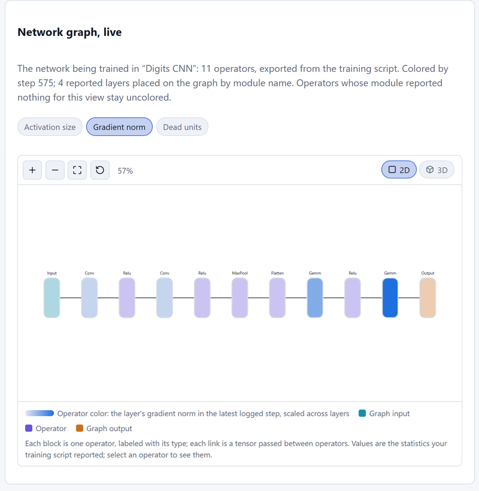

# Watching your own training live

The **Live runs** view shows a training script from your own project
while it trains: its loss, accuracy (or any metrics you choose), and the
activations of layers you pick, updating as the script logs them. The
script keeps running on your machine with your data and hardware;
NeuroVision only receives the small values you send.

## Set up

1.  Start NeuroVision (see the README). Note the backend URL, e.g.
    `http://127.0.0.1:8000`.
2.  Copy [`sdk/neurovision_client.py`](../sdk/neurovision_client.py)
    next to your training script. It is one file and needs only the
    Python standard library (plus PyTorch for `ActivationProbe`).
3.  Open **Live runs** in the browser and start your script. The run
    appears within a few seconds; click it to watch.

Use `127.0.0.1` rather than `localhost` in the URL. On Windows,
`localhost` tries IPv6 first and costs about 2 seconds per request when
the backend listens on IPv4 only (measured: 2.07 s vs 0.002 s).

## Add it to a standard PyTorch loop

``` python
import neurovision_client as nv

EPOCHS = 20
run = nv.start_run("resnet18 / lr 3e-4", total_epochs=EPOCHS,
                   url="http://127.0.0.1:8000")   # or set NEUROVISION_URL

# Optional: post-activation values of chosen layers for one fixed example.
probe = nv.ActivationProbe(
    model,
    {"layer1 ReLU": model.layer1[0].relu, "avgpool": model.avgpool},
    probe_batch=next(iter(val_loader))[0][:1].to(device),
)

with run:                                   # marks the run failed on an exception
    for epoch in range(1, EPOCHS + 1):
        train_loss, train_acc = train_one_epoch(model, train_loader)
        val_loss, val_acc = evaluate(model, val_loader)
        run.log(
            epoch=epoch,
            metrics={"loss": train_loss, "accuracy": train_acc,
                     "val_loss": val_loss, "val_accuracy": val_acc},
            activations=probe.capture(),
        )
# Leaving the `with` block calls run.finish().
```

Without `with`, call `run.finish()` at the end (or
`run.finish("failed", "why")`).

## Using a training framework

Install the SDK from the repository with `pip install ./sdk`. The base
package has no required dependencies; install the framework extra in the
environment that already contains the framework, for example
`pip install "./sdk[lightning]"`. The callbacks are created lazily, so a
script that imports `neurovision_callbacks` does not need all three frameworks
installed.

### PyTorch Lightning

Add one callback to the normal trainer. Lightning reports train and validation
metrics at the epoch boundary, and the callback merges logs that share the
same global step before sending them.

```python
from neurovision_callbacks import LightningCallback

callback = LightningCallback(
    url="http://127.0.0.1:8000",
    control=True,
    activation_layers=["net.1"],
    probe_batch=x_val[:1],
)
trainer = pl.Trainer(callbacks=[callback], max_epochs=20)
trainer.fit(model, train_loader, val_loader)
```

Lightning supports pause, resume and stop when `control=True`, plus
checkpoint and learning-rate commands when `checkpoint_dir` and an optimizer
without a scheduler are available. Health statistics use the same
`HealthMonitor` as the raw client.

### Hugging Face Trainer

The callback follows the installed `Trainer` hook order: optimizer step,
scheduler step, `on_step_end`, then logging/evaluation. A model can be built
from a config, so no model or tokenizer download is required for local tests.

```python
from neurovision_callbacks import HuggingFaceCallback

trainer = Trainer(
    model=model,
    args=training_args,
    train_dataset=train_dataset,
    eval_dataset=eval_dataset,
    callbacks=[HuggingFaceCallback(url="http://127.0.0.1:8000")],
)
trainer.train()
```

`eval_loss` and `eval_accuracy` become `val_loss` and `val_accuracy`, while
runtime and throughput summaries are omitted. Hugging Face's scheduler owns
the learning rate, so `set_lr` is not exposed. With a `probe_batch` dictionary
such as tokenizer output, selected activations can still be captured; graph
linking is not attempted for dictionary inputs.

### Keras

Keras receives the callback through `model.fit`:

```python
from neurovision_callbacks import KerasCallback

model.fit(
    x_train,
    y_train,
    validation_split=0.2,
    callbacks=[KerasCallback(url="http://127.0.0.1:8000", control=True)],
)
```

The callback adapts Keras' optimizer learning-rate property to the client's
parameter-group interface, so `set_lr` works for a scalar learning rate. A
Keras learning-rate schedule does not expose that control. Activation probes
build a small sub-model and therefore require a Functional or Sequential
model; subclassed models log metrics but skip activations.

Runnable no-download examples are in
[`sdk/examples/train_lightning.py`](../sdk/examples/train_lightning.py),
[`sdk/examples/train_hf_trainer.py`](../sdk/examples/train_hf_trainer.py) and
[`sdk/examples/train_keras.py`](../sdk/examples/train_keras.py). The exact
installed framework versions used by the integration tests are pinned in
`backend/requirements-dev.txt`.

### Framework callback limits

- Hugging Face Trainer and Keras do not provide a reliable exception hook.
  If the script crashes, the client marks the run failed from its `atexit`
  handler when the process exits; the dashboard cannot report the crash at the
  exact line where it happened.
- Hugging Face dashboard checkpoints save model weights with
  `save_pretrained`, not optimizer or scheduler state.
- `set_lr` is unavailable for Hugging Face, Lightning with a scheduler, and
  Keras with a learning-rate schedule.
- Keras has no PyTorch-style gradient/weight health statistics.
- Only Lightning rank zero and Hugging Face world-process zero log in
  distributed training.

A complete, runnable example trains a small MLP on a synthetic spiral
(no downloads):

``` bash
python sdk/examples/train_spiral.py --url http://127.0.0.1:8001
```

### What to log

-   **`metrics`**: up to 16 named numbers per step. Floats, NumPy
    scalars, and 0-d tensors all work. `val_x` (or `x_val`, `test_x`)
    is charted with `x`; accuracy-like metrics in `[0, 1]` are shown as
    percentages.
-   **`step`**: optional. Each logged step needs a larger step number
    than the last; by default the client counts 0, 1, 2, … Pass your
    global batch count to make the x-axis match your own logs.
-   **`activations`**: up to 8 layers, each up to 256 values (longer
    outputs keep their first 256). `ActivationProbe` produces this
    dictionary: it attaches forward hooks only while `capture()` runs,
    feeds the probe batch in `eval()` mode under `torch.no_grad()`,
    keeps the first example, and restores the model's previous mode.
    To see post-activation values, probe the activation modules
    (`nn.ReLU`, `nn.GELU`, …) or blocks that end in one.

A run accepts at most 10,000 logged steps. Logging every batch of a long
run reaches that quickly, so log every N batches or once per epoch.

## Training health and alerts

`HealthMonitor` measures the signals that usually show a run going wrong,
and the backend turns them into alerts in the **Health alerts** panel:

``` python
monitor = nv.HealthMonitor(
    model,
    optimizer=optimizer,          # reports the learning rate
    probe_batch=x_val[:64],       # optional: activation statistics
)
...
loss.backward()
optimizer.step()
run.log(epoch=epoch, metrics={"loss": loss, "val_loss": val_loss},
        health=monitor.collect())   # right after optimizer.step()
```

`collect()` measures, per module that owns parameters, the **gradient
norm**, **weight norm** and **update ratio** ‖Δw‖/‖w‖ since the previous
`collect()` (around 1e-3 is a common target), plus the total gradient
norm and the number of NaN/∞ gradients. With a `probe_batch`, it also
measures each `nn.ReLU`/`ReLU6`/`LeakyReLU`/`ELU`/`GELU`/`SiLU`/`Tanh`/
`Sigmoid` module's output: mean, std, the fraction of **dead units**
(≤ 0 for every probe example, ReLU family) and of **saturated outputs**
(tanh, sigmoid).

-   Call it right after `optimizer.step()`, before the next
    `zero_grad()`, as often as you log (it costs one pass over the
    parameters, plus one forward pass on the probe batch).
-   Update ratios keep one copy of the parameters on their device; pass
    `track_updates=False` to skip them for very large models.
-   Functional activations (`F.relu`) are not seen; a module used more
    than once reports its last use. Models with more than 32 parameter
    groups are grouped by top-level module.
-   With an `optimizer`, the update ratio is the average per optimizer
    step since the previous `collect()` (steps are counted with a step
    hook), so collecting once per epoch does not inflate it.
-   With mixed precision, `GradScaler` skips steps whose fp16 gradients
    overflowed (and lowers its scale); their gradients are inf by design.
    Skip `collect()` on those steps, or the run shows a non-finite
    gradients alert: compare `scaler.get_scale()` before and after
    `scaler.update()`.
-   Even without a monitor, a metric that becomes NaN or infinite is
    reported by name, so the dashboard raises a critical alert instead of
    the value silently disappearing.

Alerts fire once when a problem starts and again only after it has
cleared: non-finite loss or gradients (critical), exploding or vanishing
gradients, update ratios far too large (> 0.1) or small, dead or
saturated units, loss spikes, plateaus, and overfitting (`val_loss`
rising while `loss` falls). Each one quotes the measured numbers and
suggests what to try. The rules are listed in
[ADR 0008](decisions/0008-run-health-and-controls.md).

## See the network while it trains

Pass the model and one input batch to `start_run`, and Live Runs shows
the network's graph in 2D and 3D next to the charts, colored every step:

``` python
probe = nv.ActivationProbe.by_name(model, ["features.1", "classifier.2"], x_val[:1])
run = nv.start_run("my CNN", total_epochs=30, model=model, example_input=x_val[:1])
```

-   The script exports the model to ONNX (PyTorch's TorchScript
    exporter) and uploads it to the import endpoint; the run is linked to
    the imported graph. If export or upload fails, the run starts without
    a graph and the reason is logged.
-   **Color by:** *Activation size* (RMS of each layer's output, from
    `HealthMonitor` and `ActivationProbe`), *Gradient norm* (per module
    that owns weights), or *Dead units* (ReLU family). Select an operator
    to see its module's numbers.
-   Values are placed **by module name**: use module names
    (`ActivationProbe.by_name`) as probe labels; `HealthMonitor` already
    does. Operators whose module reported nothing stay uncolored; names
    that match no operator are listed.
-   Which models export, and what to do when one does not, is in
    [supported models](supported-models.md). Demos for an MLP, a CNN, a
    self-attention model and an autoencoder are in
    [`sdk/examples`](../sdk/examples/README.md).



## Custom visuals

Attach up to six named visuals to a step; Live Runs draws the latest ones
in **Visuals from the script**, exactly as sent:

``` python
run.log(epoch=epoch, metrics={"loss": loss}, visuals={
    "latent space": nv.scatter(z[:, 0], z[:, 1], labels=y, x_label="z1", y_label="z2"),
    "hidden state": nv.matrix(states[0], row_label="time step", col_label="unit"),
    "generated digits": nv.matrix(nv.image_grid(images, columns=4), scale="sequential"),
})
```

-   `nv.scatter(x, y, labels=None)`: at most 512 points; `labels` (0–99)
    color the points by class.
-   `nv.matrix(values, scale="diverging"|"sequential")`: a 2D array, at
    most 64 × 64 (larger ones are cropped); diverging centers on zero,
    sequential runs low to high (probabilities, pixels).
-   `nv.image_grid(images, columns=4, padding=1)`: tiles small images
    `[n, h, w]` into one matrix.

Only the latest visuals are kept for replay. The SDK splits batches so
steps with large visuals stay under the 2 MB request limit. The demos in
[`sdk/examples`](../sdk/examples/README.md) use this for latent spaces,
hidden states, generated images, graph embeddings and RL trajectories.

## System use, speed and ETA

Every logged step also carries timing and resource figures, shown in
the **System & speed** panel with charts over the run:

-   **Always:** elapsed time, time since the previous logged step, and an
    **ETA** from the recent rate of progress (the last 20 logged steps)
    towards `total_epochs`.
-   **With `psutil`:** machine CPU load and RAM, and the script's own
    CPU and memory.
-   **With `nvidia-ml-py`** (NVIDIA GPUs): per GPU, its load, memory,
    temperature and power draw. If PyTorch has initialized CUDA, the
    memory its allocator holds is reported too.

``` python
run.log(epoch=epoch, step=step, metrics={"loss": loss},
        samples=len(batch) * log_every,              # throughput
        progress=epoch - 1 + batch_index / batches)  # ETA within an epoch
```

`samples` gives a throughput figure; `progress` (fractional epochs done)
keeps the ETA right when you log several times per epoch. Pass
`track_system=False` to `start_run` to send none of this. Both packages
are optional: without them only timing is sent.

The rules add two alerts from these figures: a GPU that stays **under
20 % busy** for 5 logged steps while the script trains on CUDA (the data loader or CPU preprocessing is
usually the bottleneck, or the model is on the CPU), and GPU memory
**95 % full** (an out-of-memory error is near).

Measured figures are the script's own view: GPU load is NVML's
"utilization" (the share of time a kernel was running, not how much of
the GPU it used), and GPU memory includes other processes on that GPU.

`bench/train_live.py` fine-tunes pretrained torchvision models on the
GPU with all of this turned on; see
[vision benchmarks](vision-benchmarks.md).

## Controlling the run from the dashboard

Opt in when starting the run, then call `run.poll()` in your loop:

``` python
def save():
    torch.save(model.state_dict(), "checkpoint.pt")
    return "checkpoint.pt"            # shown in the dashboard

with nv.start_run("resnet18", total_epochs=EPOCHS, control=True,
                  optimizer=optimizer, on_checkpoint=save) as run:
    for epoch in range(1, EPOCHS + 1):
        for xb, yb in train_loader:
            if not run.poll():        # applies commands; blocks while paused
                break                 # stop was requested
            ...                       # train one batch
        if run.should_stop:
            break
        run.log(...)
# A stopped run finishes as "cancelled" (shown as Stopped).
```

| Button | Needs | What the script does |
|--------|-------|----------------------|
| Pause / Resume | `control=True` | `run.poll()` blocks until resumed (still answering the other commands) |
| Stop | `control=True` | `run.poll()` returns `False` from then on; save and leave your loop |
| Save checkpoint | `on_checkpoint=` | calls your function with no arguments in the training thread |
| Learning rate → Set | `optimizer=` | sets `lr` on every parameter group (a scheduler that sets `lr` itself will override it) |

-   Commands are **applied in your training thread**, at the `poll()`
    you choose, never from a background thread in the middle of a step.
    `poll()` only checks an in-memory queue, so call it once per batch.
-   The client fetches commands about once a second (and with every
    event batch); nothing connects *into* your machine.
-   The dashboard shows each command as *Waiting for the script…* until
    the script answers *Applied* or *Rejected* with a reason (for
    example "The run is not paused." or "on_checkpoint raised OSError.").
    Commands still pending when the run ends are marked *Expired*.

**Security:** anyone who can reach the backend can send commands to a
run that opted in, just as anyone can watch runs. Controls are therefore
off by default; enable them only with the backend on localhost or a
trusted network.

## Effect on training speed

`run.log()` converts the values, appends them to a bounded in-memory
queue, and returns; a background thread sends batches of up to 32
steps every 0.5 s. When the backend is slow or unreachable, the oldest
queued steps are dropped (counted in `run.dropped`) instead of blocking
your loop, and the client logs one warning. Nothing in the client
raises into your training code:

-   Backend unreachable at start: a warning, then a run that ignores
    every call.
-   Values the server would reject (more than 16 metrics, non-finite
    activations, …): dropped with a one-time warning. A NaN or infinite
    metric is not sent, but its name is reported so the dashboard alerts.
-   The run is finished, full, or rejected by the server: logging stops
    with a warning.

The one cost you control is `ActivationProbe.capture()`: one extra
forward pass on the probe batch (use a single example) each time you
call it.

## Security

`start_run` returns a write token that only the creating script holds;
the backend keeps only its SHA-256 digest. Logging and finishing need
`Authorization: Bearer <token>`, so other clients can list and watch
runs but cannot add events to them. Error messages sent when a `with`
block fails contain only the exception type (e.g. `The training script
raised RuntimeError.`), never its message, which can contain paths or
data.

The backend has no user accounts yet: anyone who can reach it can
create runs and watch them. Keep it on a trusted network.

## Limits and behavior

| Rule                       | Value                                           |
|----------------------------|-------------------------------------------------|
| Active runs                | 8 (`NEUROVISION_MAX_EXTERNAL_RUNS`); more → `429` |
| Steps per run              | 10,000; more → `409`                            |
| Steps per request          | 32; request body at most 2 MB                   |
| Metrics / layers / values  | 16 / 8 / 256 per step, finite numbers only      |
| Idle timeout               | 5 minutes without steps or heartbeats → run marked failed |
| Retention                  | the 32 most recent finished runs, in memory     |
| Health per step            | 32 parameter groups, 32 activation layers       |
| Alerts per run             | 200, then one "suppressed" notice               |
| Pending commands           | 16 per run; learning rate in (0, 10]            |

The client sends an empty batch (a heartbeat) after 60 seconds without
steps, so long epochs do not time out. If the script crashes without
finishing, the run is closed after the idle timeout with an explanation.
Runs live in the backend's memory and are lost when it restarts.

The REST endpoints are described in [api.md](api.md#external-runs) and
the design in [ADR 0006](decisions/0006-external-runs.md) and, for health
and controls, [ADR 0008](decisions/0008-run-health-and-controls.md). The
example [`sdk/examples/train_spiral.py`](../sdk/examples/train_spiral.py)
uses all of it; run it with `--lr 0.5` to see alerts fire.
