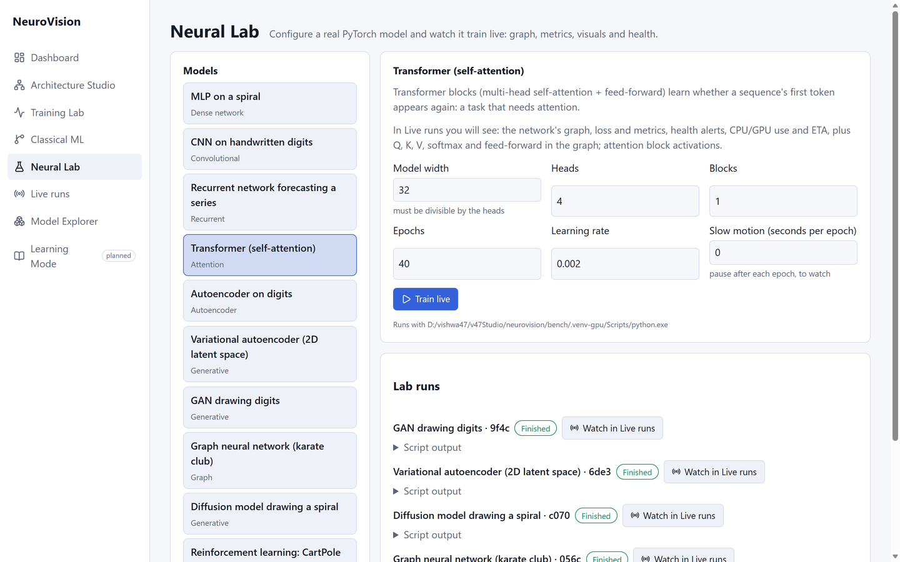
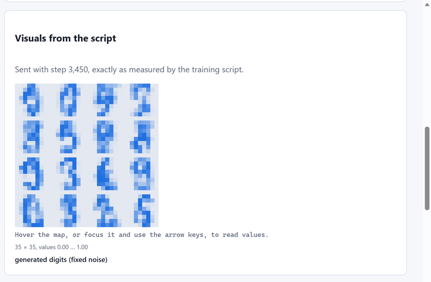
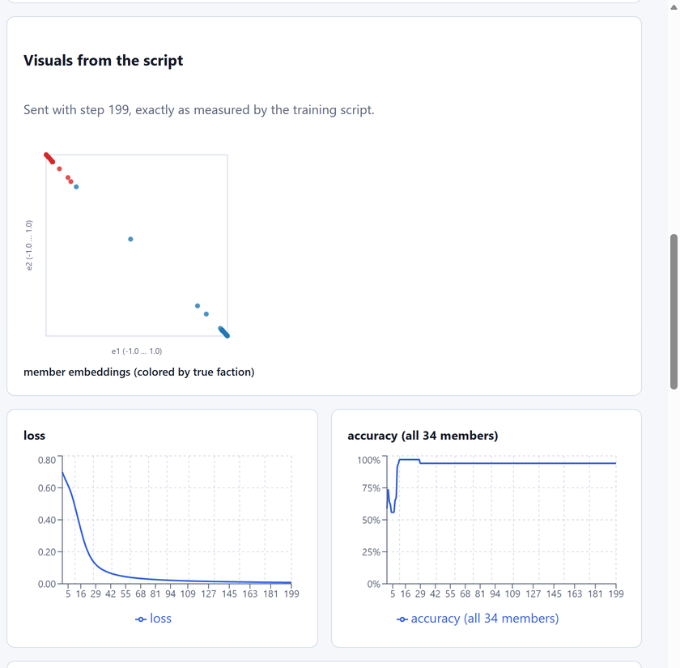
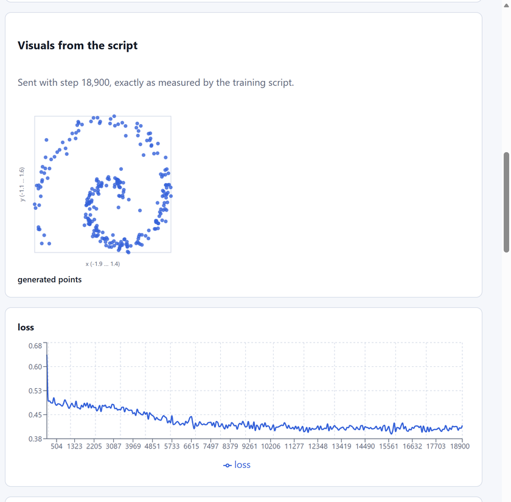
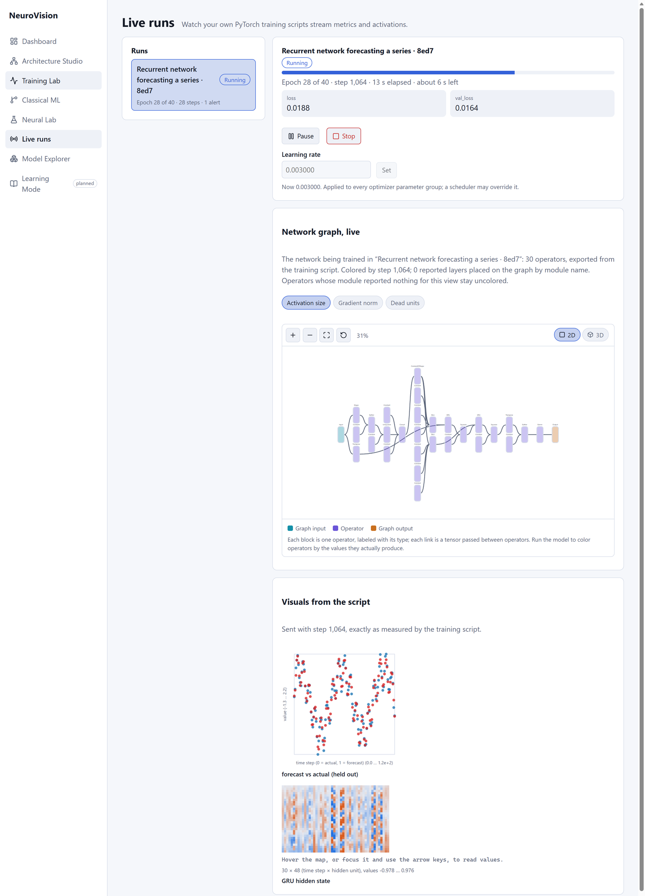

# Neural Lab

**Neural Lab** trains a real PyTorch model configured in the browser and
shows it in **Live runs** while it trains: the network's graph colored by
each layer's activity or gradients, loss and metrics, model-specific
visuals, health alerts, CPU/GPU use and ETA, and pause/stop/learning-rate
controls.

## Models

| Model | You configure | Data | Shown live, besides graph and charts |
|---|---|---|---|
| MLP on a spiral | epochs, learning rate | generated 3-arm spiral | two hidden layers' values |
| CNN on handwritten digits | convolution layers (1–4), channels, classifier units | scikit-learn digits (1,797 real images) | each convolution's ReLU output |
| Recurrent network | **LSTM / GRU / RNN**, hidden units, stacked layers | generated seasonal series | forecast vs actual; hidden state per time step |
| Transformer | width, heads, blocks | generated sequence task | Q/K/V and softmax in the graph |
| Autoencoder | code size | digits | the code of one digit |
| Variational autoencoder | – | digits | 2D latent space by class; reconstructions |
| GAN | – | digits | 16 generated digits from fixed noise |
| Graph neural network | – | Zachary's karate club (real) | 2D member embeddings; adjacency |
| Diffusion model | – | generated spiral | freshly generated points |
| Reinforcement learning (CartPole) | iterations | simulated cart-pole | pole angle over the latest episode |

Every model also takes **epochs** (or iterations), **learning rate** and
**slow motion** (seconds to pause per epoch, to watch small models that
train in seconds).

Press **Train live**, then **Watch in Live runs**: the run opens by itself
once the script has created it. The **Lab runs** list shows each run's
status and, if it fails, the script's last output lines.

| | |
|---|---|
|  |  |
|  |  |

A GRU configured in the lab, training on the GPU:

## How it works, and its safety

The lab runs NeuroVision's own demo scripts from `sdk/examples` (the same
ones you can run by hand), as separate processes that stream back through
the [SDK](live-runs.md) like any user script. Only the ten scripts listed
in `backend/app/services/lab.py` can be started, each parameter is checked
against its template's type and range, and arguments are passed without a
shell. At most two lab runs train at once; stopping a run (here or from
Live runs) ends its process, and all are stopped when the backend exits.

Settings (environment variables):

| Variable | Default | Meaning |
|---|---|---|
| `NEUROVISION_LAB_ENABLED` | on in development only | the lab starts processes, so it is off when `NEUROVISION_ENVIRONMENT` is not `development`, unless set to `true` |
| `NEUROVISION_LAB_PYTHON` | the backend's Python | the interpreter for the scripts, e.g. a CUDA build of PyTorch to train on the GPU |
| `NEUROVISION_LAB_MAX_JOBS` | 2 | lab runs that may train at once |

The scripts need PyTorch, and scikit-learn for the digits models;
`networkx` (installed with PyTorch) for the karate club.

## Results on an RTX 4070 Laptop GPU (defaults)

| Model | Result |
|---|---|
| CNN | 98.6 % test accuracy in 3.3 s |
| Recurrent (LSTM) | validation MSE 0.021 (standardized series) |
| Transformer | 99.2 % in 19 s; chance for ~9 epochs, then learns |
| VAE | loss 24.4; digit classes separate in 2D without labels |
| GAN | recognizable digits after 150 epochs |
| GNN | 94–97 % of 34 members from 2 labels |
| Diffusion | a spiral after ~300 epochs (the loss barely moves; the samples do) |
| CartPole | 500-step episodes (the maximum) by ~150 iterations |
