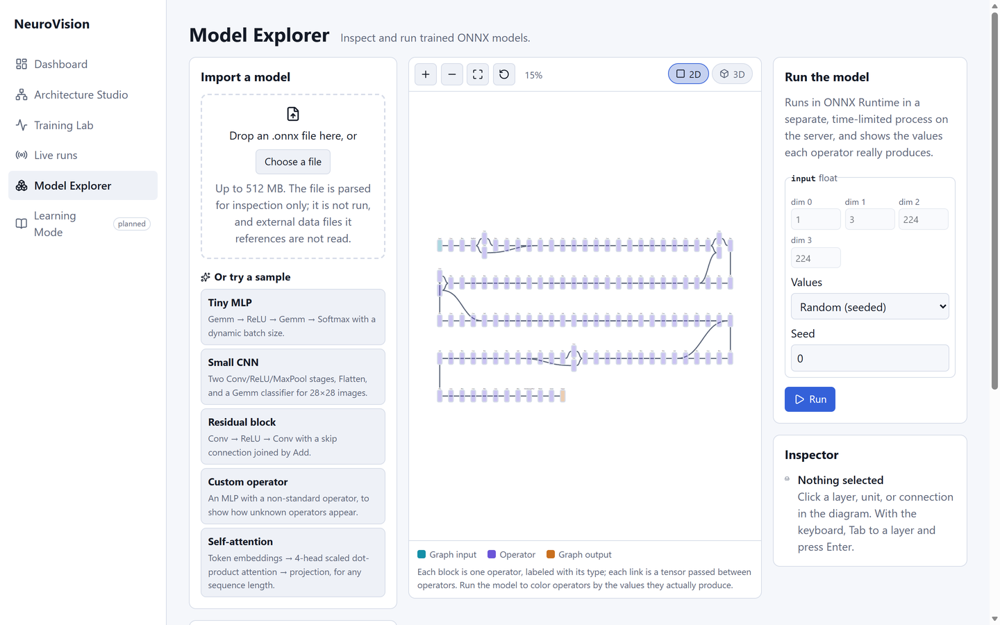
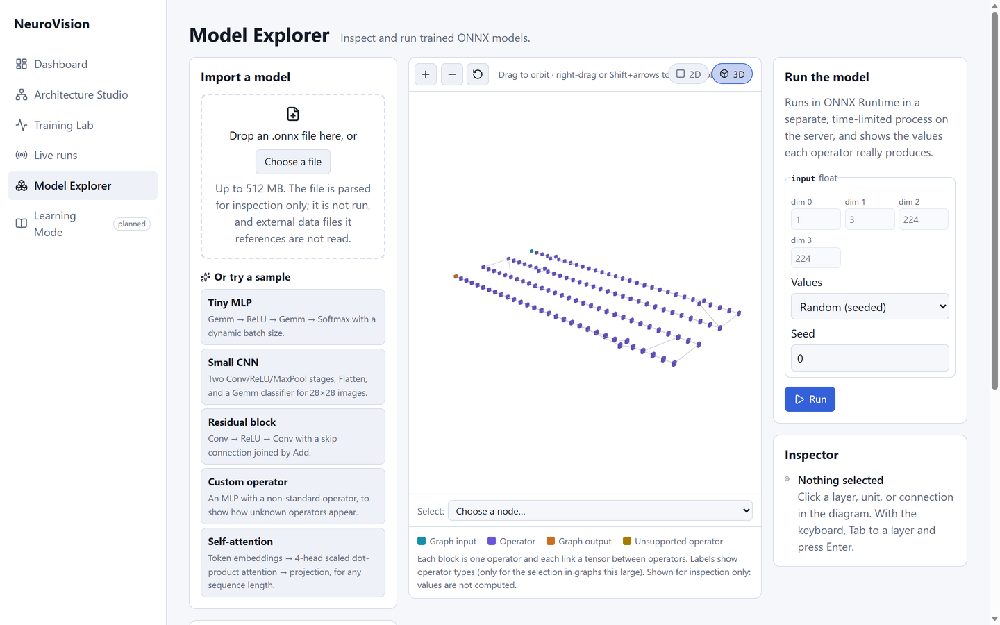
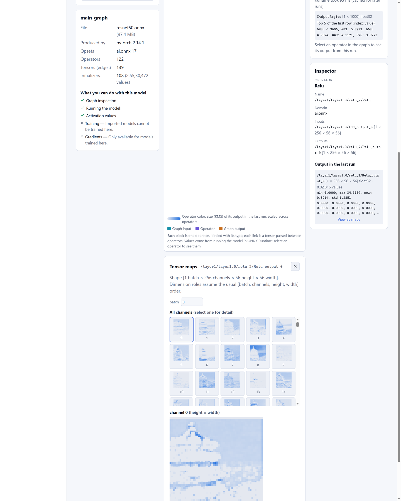
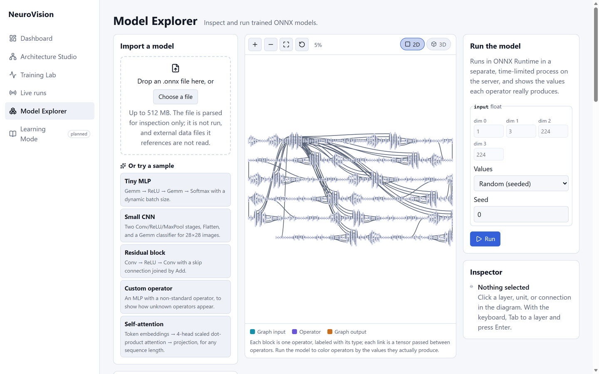
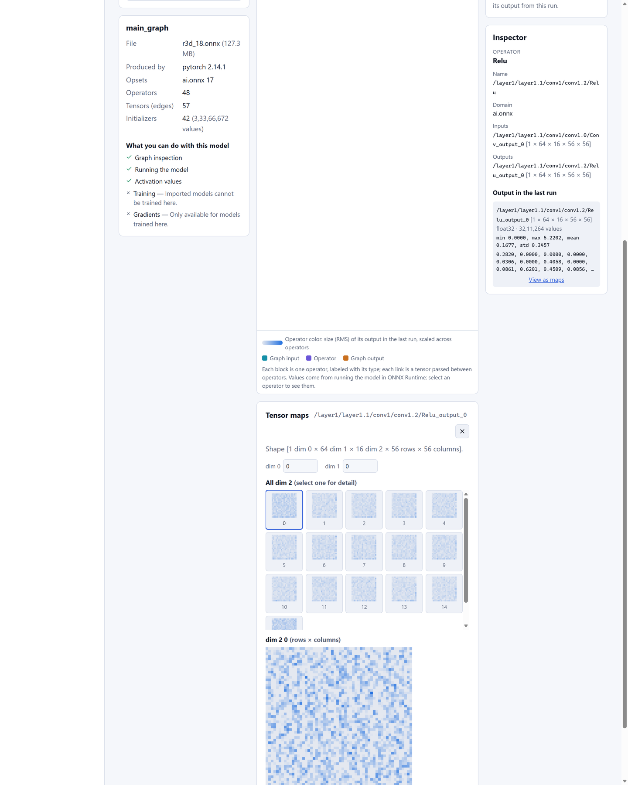
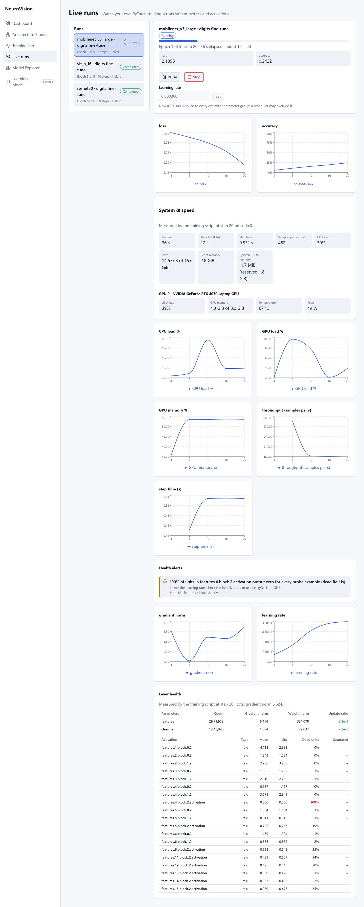

# Real vision models: speed, load, accuracy and how they look

Seven pretrained torchvision models, from a 5 M-parameter MobileNet to an
86 M-parameter Vision Transformer and a 3D (video) CNN, measured on one
laptop, exported to ONNX, opened in NeuroVision's 2D and 3D views, run on a
real photo, and fine-tuned on the GPU while streaming to Live Runs.

Everything here can be reproduced with the scripts in [`bench/`](../bench/):

``` bash
python -m venv bench/.venv-gpu
bench/.venv-gpu/Scripts/pip install torch torchvision --index-url https://download.pytorch.org/whl/cu130
bench/.venv-gpu/Scripts/pip install psutil nvidia-ml-py onnx scikit-learn
bench/.venv-gpu/Scripts/python bench/vision_models.py       # speed, load, ONNX export
backend/.venv/Scripts/python bench/check_onnx.py             # ONNX Runtime vs PyTorch
bench/.venv-gpu/Scripts/python bench/train_live.py --model resnet50   # live fine-tune
```

Raw numbers: `bench/results/vision_models.json` and `bench/results/training.json`.

## Machine

| | |
|---|---|
| GPU | NVIDIA GeForce RTX 4070 Laptop GPU, 8 GB |
| CPU | Intel Core i9-13980HX (32 threads) |
| RAM | 16 GB |
| Software | PyTorch 2.14.1 + CUDA 13.0, ONNX Runtime 1.31 (CPU), Windows 11 |

During every GPU measurement the card drew only **52–55 W** at 96–100 %
load and 69–73 °C, so it was running power-limited (laptop power mode
or battery). Plugged in on a performance profile, the same card is
allowed far more power, and the GPU figures below should rise.

## Inference: size, speed and load

Batch 1 latency is fp32; throughput is fp16 autocast at the batch shown.
"Load" is the average while the throughput loop ran (sampled every 0.1 s).

| Model | Family | Params | GMACs | ImageNet top-1 (reported) | GPU latency b1 | GPU throughput | GPU / CPU load | Peak GPU mem | PyTorch CPU b1 | ONNX Runtime CPU b1 |
|---|---|---:|---:|---:|---:|---:|---|---:|---:|---:|
| MobileNetV3-Large | CNN (mobile) | 5.5 M | 0.22 | 75.3 % | 6.1 ms | **3,531 /s** (b64) | 96 % / 16 % | 575 MiB | 25.9 ms | **1.8 ms** |
| EfficientNet-B0 | CNN (mobile) | 5.3 M | 0.39 | 77.7 % | 9.1 ms | 1,955 /s (b64) | 97 % / 27 % | 654 MiB | 34.7 ms | 4.8 ms |
| ResNet-18 | CNN (residual) | 11.7 M | 1.81 | 69.8 % | **2.8 ms** | 2,694 /s (b64) | 98 % / 15 % | 747 MiB | 26.6 ms | 5.3 ms |
| ResNet-50 | CNN (residual) | 25.6 M | 4.09 | 80.9 % | 6.5 ms | 869 /s (b64) | 99 % / 13 % | 638 MiB | 63.9 ms | 12.0 ms |
| ConvNeXt-Tiny | CNN (modern) | 28.6 M | 4.46 | **82.5 %** | 4.5 ms | 752 /s (b64) | 99 % / 12 % | 659 MiB | 45.5 ms | 34.7 ms |
| ViT-B/16 | Transformer | 86.6 M | 11.3 | 81.1 % | 9.6 ms | 401 /s (b32) | 100 % / 10 % | 698 MiB | 134 ms | 108 ms |
| R3D-18 | 3D CNN (video, 16×112×112) | 33.4 M | 40.7 | 63.2 % (Kinetics-400) | 10.2 ms | 187 clips/s (b16) | 97 % / 14 % | 964 MiB | 241 ms | 300 ms |

What this shows:

-   **Latency at batch 1 is mostly overhead**, not arithmetic: the 0.2-GMAC
    MobileNet (6.1 ms) is slower than the 1.8-GMAC ResNet-18 (2.8 ms)
    because it launches many small depthwise kernels. Throughput at a
    real batch size follows the arithmetic much more closely.
-   **The GPU was the bottleneck** in every throughput test (96–100 %
    busy, CPU 10–27 %): the data was already on the GPU.
-   **ONNX Runtime on the CPU beats eager PyTorch on the CPU** by 5–14×
    for MobileNet, EfficientNet and the ResNets (graph optimizations and
    fused kernels), but only 1.2–1.3× for ConvNeXt and ViT, and it is
    slower for the 3D CNN. MobileNetV3 runs in 1.8 ms per image on a
    laptop CPU.
-   **The 3D CNN is the heaviest by far**: 40.7 GMACs per clip, about 10×
    ResNet-50, because every convolution also slides over 16 frames.

## Predictions on real photos

Top-1 on the two photos that ship with scikit-learn (no download). The
first is a Chinese pagoda by a lake, the second a close-up of a pom-pom
dahlia.

| Model | Pagoda photo | Dahlia photo |
|---|---|---|
| MobileNetV3-Large | palace (39 %) | sea anemone (15 %) |
| EfficientNet-B0 | palace (56 %) | honeycomb (12 %) |
| ResNet-18 | bell cote (53 %) | honeycomb (67 %) |
| ResNet-50 | palace (37 %) | daisy (8 %) |
| ConvNeXt-Tiny | palace (54 %) | daisy (23 %) |
| ViT-B/16 | palace (42 %) | ant (13 %) |

ImageNet has **no "dahlia" class**, so every model picks its nearest
texture or flower ("daisy", "honeycomb", "sea anemone") with low
confidence. A closed label set is a real limitation of pretrained
classifiers: fine-tune on your own classes when they are not among the
1,000. The video model was fed a slow pan over each still photo, so its
guesses ("contact juggling", "scuba diving") are meaningless; it is here
to measure the cost of 3D convolutions.

## ONNX export and import

| Model | ONNX size | Operators | Max \|ONNX − PyTorch\| | Same top-1 | Import into NeuroVision | One run in the Model Explorer |
|---|---:|---:|---:|:-:|---:|---:|
| ResNet-50 | 97 MB | 122 | 2.4e-5 | ✓ | 1.0–1.8 s | 75–108 ms, all 121 tensors captured |
| ViT-B/16 | 331 MB | 1,016 | 1.8e-5 | ✓ | 3.4–5.6 s | 196–217 ms (captures on request) |
| R3D-18 | 127 MB | 48 | 4.5e-6 | ✓ | 1.0–1.7 s | 664 ms, all 47 tensors captured |

All seven exports matched PyTorch to within 2.4e-5 with the same top-1
class. In the Model Explorer, ResNet-50 and ViT-B/16 fed the pagoda
photo both report index 698 first, which is ImageNet's "palace": the
same answer PyTorch gave.

Files above 64 MB need a higher limit: start the backend with
`NEUROVISION_MAX_UPLOAD_BYTES=536870912` (512 MB). The Model Explorer
reads the limit from `GET /health`.

## How the heavy models look

**ResNet-50, 2D.** Long operator chains wrap into rows (left to right,
then right to left), so 122 operators fit the screen. Blocks are shaded
by how strongly each operator fired on the photo:



**ResNet-50, 3D.** The same wrapped rows, laid out in depth:



**ResNet-50 feature maps** of `layer1.0` (256 channels, 56×56) for the
pagoda photo, with **Each map on its own scale**: the tower and the
shoreline are visible in many channels. On one shared scale most maps
look blank, because a few activations reach 34 while the mean is 0.8.



**ViT-B/16, 2D:** 1,016 operators in six rows.



**ViT-B/16 attention**, encoder layer 0, 12 heads over 197 tokens (196
patches + the class token). Over 200 operators NeuroVision keeps only
the operators you ask for: **Capture this operator and run again**
re-runs the model with that softmax captured. Scaled per head, heads 2,
5, 8 and 10 show clear structure; on a fixed 0–1 scale they look blank,
since 197 weights per row average 0.005.


**R3D-18 (video)**: a 5D activation `[batch, channels, frames, height,
width]`; pick a channel and every frame shows as a map (here with a
random clip).



## Fine-tuning on the GPU, streamed live

`bench/train_live.py` replaces each model's head with 10 classes and
fine-tunes it on scikit-learn's 1,797 handwritten digits (8×8, upsampled
on the GPU to 224×224; 1,437 train / 360 test, stratified). AdamW,
one-cycle learning rate, fp16 autocast with `GradScaler`, batch 64 (32
for ViT). Every 4 batches it logs loss, accuracy, HealthMonitor
statistics and system use to Live Runs; test accuracy at the end of each
epoch.

| Model | Epochs | Train time | Train images/s | Test (360 images) | Test accuracy | Peak GPU memory |
|---|---:|---:|---:|---:|---:|---:|
| ResNet-18 | 5 | **28.8 s** | 249 | 0.16 s | 98.9 % | 1.6 GB |
| ResNet-50 | 6 | 64.9 s | 133 | 0.44 s | 99.4 % | 3.3 GB |
| ConvNeXt-Tiny | 5 | 71.3 s | 101 | 0.52 s | 99.4 % | 5.3 GB |
| ViT-B/16 (batch 32) | 5 | 82.3 s | 87 | 1.02 s | **99.7 %** | 4.1 GB |
| EfficientNet-B0 | 5 | 93.7 s | 77 | 0.20 s | 98.6 % | 2.9 GB |
| MobileNetV3-Large | 5 | 79.1 s | 91 | 0.12 s | **52.5 %** ⚠ | 1.5 GB |
| MobileNetV3-Large, BatchNorm momentum 0.1 | 5 | 67.4 s | 107 | 0.12 s | 98.6 % | 1.5 GB |

Times include the per-epoch test pass and HealthMonitor; the first epoch
also includes cuDNN autotuning.

Two findings worth knowing:

-   **MobileNetV3 trained to 99 % but tested at 52 %.** torchvision
    builds MobileNetV3 with BatchNorm momentum 0.01, so in about 115
    steps the running statistics barely move from ImageNet's towards
    these images, and evaluation (which uses them) is wrong. With
    momentum 0.1 (`--bn-momentum 0.1`) the same run tests at 98.6 %.
    It is the only model here built with 0.01 (EfficientNet-B0 and the
    ResNets use PyTorch's default 0.1; ConvNeXt and ViT have no
    BatchNorm), and the only one that failed. Live Runs showed the
    symptom as train accuracy far above `val_accuracy`.
-   **Monitoring costs speed.** Collecting per-layer health every 4
    batches slowed training by about 30 % for ResNet-18 (249 → 359
    images/s without it) and 20 % for MobileNetV3 (107 → 131). Collect
    every 20–50 batches on long runs.

Training is much slower than inference (ResNet-50: 133 vs 869 images/s):
a backward pass costs about twice the forward pass, the batches are
small, each step syncs to read the loss, and the monitoring above adds
its own passes.

### What Live Runs showed

The **System & speed** panel updates with every logged step: elapsed time,
**ETA** (from the recent rate, within an epoch thanks to `progress=`),
step time, images per second, CPU and RAM, the script's own memory,
PyTorch's CUDA memory, and per GPU its load, memory, temperature and
power, each also charted over the run:



Observed during these runs: GPU load mostly 90–100 % with dips during
the per-epoch test pass and health collection; GPU memory 4–7 GB of 8
(including other processes); 49–55 W; 67–72 °C; CPU 15–30 %. Health
alerts were real findings, not noise: MobileNetV3 had a squeeze-and-excite
ReLU that was 100 % dead on the probe batch. A first ViT run raised a
false "NaN gradients" alert from `GradScaler`'s deliberate overflow
steps; the script now skips health on those steps, and the alert's
advice explains it.

## Where this is useful

-   **Choosing a model for a deployment target.** The table answers
    "what fits": MobileNetV3 or ResNet-18 for real-time on a CPU or
    edge device (2–5 ms with ONNX Runtime), ConvNeXt-Tiny or ViT-B/16
    when accuracy matters and a GPU is available, a 3D CNN only with a
    GPU budget for video.
-   **Debugging transfer learning.** Watching train vs test accuracy,
    gradient and update ratios, and dead units live caught the
    MobileNetV3 BatchNorm problem in the first epochs instead of after
    the run.
-   **Finding the bottleneck.** GPU load under 20 % (an alert) means the
    data pipeline or CPU is limiting; GPU memory near full warns before
    an out-of-memory crash; ETA and throughput show whether a change
    (batch size, mixed precision, fewer health checks) actually helped.
-   **Explaining models.** Feature maps on a real photo and per-head
    attention show what a CNN or a transformer responds to; useful in
    teaching, in reviews, and to sanity-check that preprocessing (crop,
    normalization) is what the model expects.
-   **Verifying exports.** Importing the ONNX file, running it on the
    same input and comparing the top classes confirms the deployed model
    is the trained one.
-   **Video and medical 3D data.** The 5D view covers Conv3d models (action
    recognition, CT/MRI volumes): each frame or slice of a channel as a
    map.

## Limits of these measurements

-   One laptop, power-limited GPU, Windows; numbers are medians of short
    runs, not a controlled benchmark suite.
-   ImageNet accuracies are torchvision's reported figures, not
    re-measured here. Digits fine-tuning is an easy task; it
    demonstrates the pipeline and telemetry, not model quality.
-   NVML "GPU load" is the share of time a kernel was running, not how
    much of the GPU it used.
-   Feature maps of the video model were taken with a random clip.
